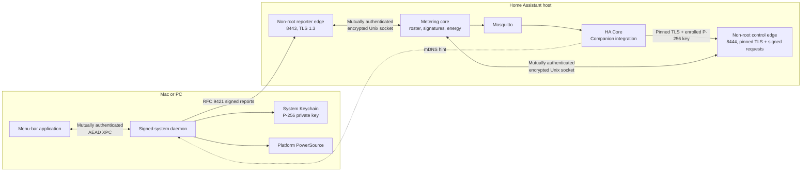

# Native Computer Reporters — Design

## Decision summary

The add-on remains the server and reporters push whole-system watts over TLS 1.3. Discovery is untrusted routing only;
trust is established by human SAS confirmation or MDM-delivered server-trust configuration and token. Report authentication uses the
reporter's P-256 key, not a permanent bearer token. Dynamic reporters use a separate roster, push-reading pipeline,
and MQTT v2 per-device messages; current polled devices and v1 remain unchanged.

The reporter is a separate Rust repository and product. Apple-silicon support is gated by reproducible code-only
qualification. The selected `AppleSmartBattery.PowerTelemetryData` property has no documented public contract in the
cited official Apple sources, so the qualification tests its units, internal consistency, freshness, load response,
mode transitions, and resource use. Unsupported or inconsistent sources fail closed. The product labels accepted
values Apple-reported system power and makes no external-calibration, physical-accuracy, or billing-grade claim.

## System architecture



## Trust boundaries and process model

- The network, mDNS record, internal add-on bridge, MQTT broker, clients, and controllers are untrusted.
- Separate non-root reporter and control edges parse TLS/HTTP under distinct AppArmor child profiles. The reporter edge
  can read only its active reporter leaf key and per-boot authenticated IPC credential. The control edge can read only
  its dedicated control leaf key and its own per-boot authenticated IPC credential. Neither edge can access `/data`
  directly, HA configuration, reporter CA signing material, token hashes or verifiers, Supervisor credentials, the
  other edge's keys or IPC credential, or unrelated secrets.
- The metering core owns durable identity state and independently verifies canonical request material received over a
  mutually authenticated, encrypted, mode-restricted Unix socket. Separate per-boot IPC credentials authenticate each
  expected edge process on both ends and cannot authorize the other edge's method set; compromise of an edge still
  cannot forge a reporter or integration signature.
- The integration reaches internal control port 8444 for initial pairing or compromise recovery over TLS 1.3 used only
  as encryption-only provisional transport while a fresh administrator-configured
  `remcp1.<absolute-expiry>.<32-byte-random-secret>` credential is active at both ends. Its absolute expiry is bound into
  every proof and never resets on reload/restore. The integration hashes the leaf SPKI observed on that connection into the HMAC transcript; only
  the exact bootstrap or recovery phase routes can dispatch, and only their success schemas or bounded problem errors
  can return. After bilateral HMAC-SHA-256 proofs enroll its P-256 control key and pin the exact observed add-on control
  SPKI, the integration closes that connection. Every later control connection requires the exact pin and every request
  uses RFC 9421; pin failure never downgrades to provisional TLS without a new authenticated config flow and fresh
  secret. There is no permanent control bearer token. Supervisor discovery carries routing metadata only and updates
  are accepted only from the approved add-on slug.
- Initial control bootstrap uses two 32-byte nonces, HMAC commitments and opposite-role proofs over the canonical
  length-delimited transcript in requirement 7.5a. In the authorizing transaction, the add-on stores the consumed
  credential digest through its absolute expiry plus five minutes and disables bootstrap; an old backup cannot extend
  the embedded expiry, and after expiry the credential is unusable even without its tombstone. Before successful bilateral proof, internal-network access, proxy
  claims, discovery content, and bootstrap responses grant no control authority. Rotation binds current/new signatures
  and HA-admin confirmation to one expiring transcript digest.
- Loss or suspected compromise uses the three-phase `rem-control-recovery-v1` exchange under a fresh secret. Its
  opposite-role proofs bind the instance, current key thumbprint/generation, current and observed SPKI/generations,
  exact revocation scope, independent nonces, expiry, and recovery generation. The core verifies the integration proof
  before one atomic revocation and releases its proof only after commit; the integration verifies that proof before
  accepting success. Recovery consumes its secret, so later pairing uses a second fresh secret and cannot reactivate
  the old key.
- Reporter private keys remain non-exportable in the System Keychain. On each XPC connection, the daemon and menu app
  mutually validate the peer audit token against the pinned bilateral designated requirements before completing an
  ephemeral P-256 ECDH handshake. HKDF-SHA-256 derives independent directional XChaCha20-Poly1305 keys and 16-byte
  nonce prefixes bound to both audited code identities, the handshake transcript, and a random session ID. Every
  enrollment/status-only message uses the directional prefix plus the next uint64 big-endian counter as its 24-byte
  nonce; its authenticated data fixes the protocol version, session ID, direction, method, and counter. Both peers
  reject plaintext, unauthenticated or altered envelopes, an unexpected counter, counter wrap or nonce reuse, and
  messages from an old session. Connection close erases the keys/counters and invalidates the session ID before a new
  handshake; the fresh session plus exact-next-counter check is the freshness and replay boundary. There is no fallback
  path. XPC exposes no arbitrary command/file operation.

## Discovery and enrollment

Home Assistant Core advertises `_rem-reporter._tcp.local.` using its shared zeroconf instance. Its 12-character
DNS-SD Service Name, `rem-reporter`, stays within the 15-character limit in RFC 6763 section 7.2. The bridged add-on
does not request `host_network`. The advertised instance/port is a hint. Interactive first contact permits
provisional TLS as encryption only, without server authentication, solely for the bounded enrollment endpoints and
memory-only pending state until reciprocal SAS completes. Managed enrollment never uses provisional trust: it verifies
the artifact-selected CA-SPKI pin or platform-PKI identity before sending its proof.

```mermaid
sequenceDiagram
    participant R as Reporter
    participant E as HTTPS edge
    participant S as Metering core
    participant H as HA integration
    participant U as Administrator

    R->>E: Provisional TLS; enrollment key + nonce commitment
    E->>S: Canonical enrollment request
    S-->>R: Core commitment + mode-specific trust identity
    R->>S: Reveal reporter nonce after both commitments
    S-->>R: Reveal core nonce; reporter verifies commitment
    Note over R,S: Both derive six words from exact canonical transcript
    S->>H: Pending record over authenticated control API
    H->>U: Home Assistant Discovered card
    U->>H: Verify reporter phrase; approve transcript
    H->>S: Authenticated HA-side confirmation
    S-->>R: HA confirmed; reporter confirmation still required
    U->>R: Explicitly confirm HA showed the same phrase
    R->>S: Signed reporter-side confirmation
    S->>S: Atomically activate only after both confirmations
    S-->>R: Active status
    R->>R: Store CA-SPKI pin or platform-PKI server identity; keep Keychain identity
```

The precise reciprocal human confirmation is a release gate: an untrusted server cannot cause trust persistence merely
by claiming approval, and neither side alone can activate the roster entry. Interactive first contact is encryption-only
provisional TLS and is limited to the bounded enrollment endpoints and memory-only pending state until SAS verifies the
server identity. The identity is one canonical ASCII URI of the exact form `https://<host>:<port>`, where `https` is
literal lowercase, `host` is the configured lowercase canonical IDNA A-label DNS name with no trailing dot, and `port`
is explicit canonical decimal in 1–65535 with no leading zeroes. Userinfo, IP literals, an empty host, path (including
`/`), query, fragment, percent encoding, Unicode U-labels, and alternate numeric encodings are invalid. Before the
reporter fixes or sends its commitment, it derives the identity from and compares it with the configured connection
target, then sends that identity with its commitment. Before fixing or returning its own commitment or allocating
pending state, the core compares the exact scheme, host, and port to its configured reporter identity. A mismatch
aborts, and redirects are never followed. After SAS confirmation, the reporter persists and uses those exact fields:
generated and operator private-CA modes combine them with the transcript CA-SPKI pin, while platform-PKI mode also verifies that exact host. Cross-origin or one-field identity
changes require a new enrollment and cannot reuse the transcript.

The reporter and core generate independent 32-byte `reporter_nonce` and `core_nonce` values, commit to
each through `rem-interactive-commit-v1` before either reveal, reveal reporter first and core second, and reject a
mismatched commitment before continuing. The fixed `REM-TRANSCRIPT || 0x01` length-delimited encoding, typed field
order, 4 KiB transcript cap, exact interactive fields, digest, HKDF-SHA-256 phrase derivation, and normative PGP word
mapping are defined in requirement 4.3. For output bytes `b[0]` through `b[5]`, the rendering is exactly
`Even[b[0]] Odd[b[1]] Even[b[2]] Odd[b[3]] Even[b[4]] Odd[b[5]]` using the pinned 256-entry tables, with one ASCII
space between words. RFC 6189 defines only a two-word, 16-bit B256 SAS; this protocol deliberately extends that
rendering rather than claiming RFC 6189 conformance. Shared Python/Rust vectors fix every transcript byte, digest,
derived byte, selected list and index, and rendered word; mutations of any field, field length/order,
commitment/reveal, nonce, JWK, SPKI/trust mode, expiry, or phrase must fail.

MDM bypasses interactive SAS only because it pre-delivers authenticated configuration. An authenticated,
HA-administrator-authorized issuance request carries a client-generated operation ID and managed subject ID and
returns the strict `rem-managed-enrollment-v1` JSON artifact defined in requirement 4.5. Its only fields are `schema`;
`server.scheme`, `server.host`, `server.port`, `server.trust_mode`, and `server.ca_spki_sha256`; `token_id`; `token`;
and `expires_at`. The server identity uses an IDNA A-label host and explicit port. Generated and operator private-CA
modes use `ca-spki-sha256` and an exact CA-SPKI pin; operator public-PKI mode uses `platform-pki`, a null pin field, and
normal hostname/chain verification. Leaf-SPKI pins are unsupported. The managed reporter verifies the selected trust
mode before sending any proof. `token_id` is a public random 128-bit value, `token` is a unique 256-bit one-use raw
token, and `expires_at` is 24 hours after issuance. The response uses `Cache-Control: no-store`; the core retains only
`token_verifier = SHA-256(token)` plus a durable public operation record, and no server component writes or retains the
artifact or raw token after the response.

The public record maps the client-held operation ID to subject, token ID, expiry, and `issued`, `revoked`, `consumed`,
or `expired` state. Signed status and revoke routes expose or mutate only that record. One subject can have only one
issued token, and the global operation-record cap is 2,000. If issuance or revocation response delivery is uncertain,
the administrator queries status, idempotently revokes by issuance operation ID, verifies that the old proof is
rejected, and only then starts replacement with a fresh operation ID. Records survive restart through five minutes
after token expiry. This bounds repeated response-loss recovery without storing raw token responses or leaving an
unidentifiable live token. The administrator imports the successful artifact directly into the MDM's per-device secret
store, whose read and delivery permissions are limited to enrollment administrators and the target machine selected
for that record. The MDM delivers it only to that machine over its authenticated encrypted channel. A required staging
file is created with `O_EXCL` and owner-only mode 0600, excluded from backup and synchronization, and unlinked
immediately after import. MDM and reporter copies are deleted after durable enrollment success and no later than
revocation or expiry.

The raw token never crosses or becomes available to the TLS edge. The core issues a 60-second one-use opaque challenge
containing a 32-byte core nonce, expiry, and core-only MAC, and the reporter generates an independent 32-byte nonce.
The reporter computes
`proof_key = HKDF-SHA-256(token_verifier, salt=core_nonce, info="rem-managed-enroll-proof-v1")`, then computes
HMAC-SHA-256 over the exact at-most-4-KiB `rem-managed-enrollment-v1` transcript defined in requirement 4.5. That
transcript uses the common binary encoding and fixes schema, purpose, decoded token ID, bounded opaque challenge, both
nonces, canonical scheme/host/port, exact trust mode and decoded CA-SPKI-or-empty value, proposed canonical JWK and
thumbprint, and expiry in named order. The proposed P-256 key signs the same bytes. The core validates the challenge
MAC/expiry, proof, proposed-key signature, server identity, and token status
itself. One durable transaction consumes the token and nonce and creates the roster identity; any failure commits
nothing. The response is released only after that transaction is durable. Proofs are indistinguishable on failure and
cannot be replayed or rebound to another server or JWK. Shared vectors cover honest flow, edge-observed proof replay,
substituted JWK/server identity, forged challenge, expired/revoked/already-used token, edge compromise, and crash at
each transaction boundary.

## Identity and signed request profile

- Enrollment public key: exact JWK fields `{kty:"EC", crv:"P-256", x, y}`; reject private `d`, extras, malformed
  lengths, compressed points, and off-curve points.
- Reporter ID: full base64url RFC 7638 thumbprint captured from the initial enrollment key. The roster retains this
  immutable identifier. Routine rotation first sends the proposed key and a client operation ID under the current key
  to the exact challenge route. The core durably returns one fixed ten-minute `rotation_id`, 32-byte core nonce,
  expiry, and digest. The old and new keys then sign the same transcript, including both IDs and the core nonce, and
  submit those signatures to the exact completion route. HA must authenticate an administrator and confirm that exact
  pending transcript digest, current generation, nonce, and expiry over the control channel. Challenge, pending
  signatures, and exact results survive restart; one live rotation is allowed per reporter, exact phase retries return
  their original result, and changed, duplicate-out-of-order, consumed, or expired phases return 409 without extending
  expiry. The core atomically swaps the key only when all three approvals match and remain live. Loss or suspected
  compromise requires revocation and re-enrollment.
- Message signatures: one RFC 9421 signature labelled `rem`, algorithm `ecdsa-p256-sha256`, RFC 9530 SHA-256
  Content-Digest, fixed component sets and purpose-specific tags (`rem-enroll-v1`, `rem-managed-enroll-v1`,
  `rem-challenge-v1`, `rem-session-v1`, `rem-report-v1`, `rem-rotate-challenge-v1`, `rem-rotate-v1`). Reporter
  Signature-Input parameters are exactly `keyid`, `alg`, and `tag`; reporters transmit no client wall-clock timestamp.
  Freshness comes exclusively from server-issued pending-enrollment, challenge, session, and sequence state.

Session/replay flow:

1. The reporter fetches a stateless challenge-allocation context containing a 32-byte core random value, fixed
   five-minute interval, and core MAC. The context changes on restart and at fixed boundaries; requests cannot extend
   it. The reporter then sends `POST /api/v1/challenges` with reporter ID and a random 128-bit client nonce. Its active
   long-term key signs the fixed `rem-challenge-v1` purpose, method, path, content type, content digest, reporter ID,
   client nonce, complete allocation context, and signature parameters.
2. The edge applies connection, parse, source-rate, and global cryptographic-work limits, then forwards canonical
   material. Before allocating state, the core validates the current allocation context, active reporter/key,
   authorization, purpose, signature, and per-reporter nonce replay cache. An exact duplicate returns the existing
   challenge and original expiry; it never refreshes lifetime. A different nonce while a challenge is live returns 409
   without replacement. A consumed,
   expired, or previously seen nonce returns 409 without allocation. Replay records remain until their allocation
   context expires; a restart invalidates the context, so captured requests cannot allocate afterward.
3. The core returns one 32-byte challenge, memory-only, 60-second/single-use. Because only authenticated reporters can
   allocate and each identity can hold one, spoofed victim IDs cannot churn victim state or fill the global pool.
4. Signed `POST /api/v1/sessions` proves possession and receives a random 128-bit session ID.
5. Signed reports carry `sid` and increasing `seq`. The core records the last accepted request identity as `sid`,
   `seq`, canonical body bytes, Content-Digest, and every signed request field, together with the exact successful HTTP
   status and response body. The same `seq` is an identical retry only when every identity field matches and the
   signature verifies; it returns that recorded result without repeating energy integration, state transitions, or
   publication. The same `seq` with any changed identity field, or a lower `seq`, returns 409.
6. Sessions expire after 10 minutes idle or one hour total. Server restart invalidates all sessions, and the reporter
   opens a new one. No per-report disk write is required.

## HTTP APIs and limits

Reporter endpoints use these hard body ceilings; `none` forbids a body and response values are successful-body
ceilings. Every RFC 9457 error response, including headers and body, fits the separate complete-response 2 KiB cap:

| Endpoint | Maximum request | Maximum response | Success | Purpose |
| --- | ---: | ---: | --- | --- |
| `POST /api/v1/managed-enrollment-challenges` | 1 KiB | 1 KiB | `201 Created` | Token ID, reporter nonce, server identity, proposed JWK |
| `POST /api/v1/enrollments` | 4 KiB | 2 KiB | `201 Created` | Interactive commitment or managed proof and proposed-key signature |
| `POST /api/v1/enrollments/{id}/reveal` | 256 B | 2 KiB | `200 OK` | Reveal nonce and complete transcript |
| `POST /api/v1/enrollments/{id}/confirm` | 512 B | 1 KiB | `200 OK` | Signed reporter-side SAS confirmation |
| `GET /api/v1/enrollments/{id}` | none | 2 KiB | `200 OK` | Bounded long-poll for status |
| `GET /api/v1/challenge-context` | none | 1 KiB | `200 OK` | Stateless five-minute allocation context |
| `POST /api/v1/challenges` | 512 B | 1 KiB | `201 Created` | Long-term-key-signed challenge allocation |
| `POST /api/v1/sessions` | 1 KiB | 1 KiB | `201 Created` | Signed session creation |
| `POST /api/v1/reports` | 1 KiB | 1 KiB | `200 OK` | Signed whole-system watts |
| `POST /api/v1/reporters/{id}/key-rotations/challenges` | 2 KiB | 2 KiB | `201 Created` | Durable core-nonce rotation challenge |
| `POST /api/v1/reporters/{id}/key-rotations/{rotation_id}` | 1 KiB | 2 KiB | `202 Accepted` | Old/new transcript signatures |

Bootstrap and control routes use these exact methods, paths, body and item ceilings, and successful statuses. `none`
forbids a request body. Response ceilings apply to successful bodies; every RFC 9457 error response, including headers
and body, remains within the separate complete-response 2 KiB ceiling.

| Method | Path | Maximum request | Maximum response | Success | Purpose |
| --- | --- | ---: | ---: | --- | --- |
| `POST` | `/control/v1/bootstrap/commit` | 2 KiB | 2 KiB | `201 Created` | Control-key/SPKI commitments |
| `POST` | `/control/v1/bootstrap/reveal` | 1 KiB | 2 KiB | `200 OK` | Control pairing nonce reveal |
| `POST` | `/control/v1/bootstrap/confirm` | 1 KiB | 2 KiB | `200 OK` | Opposite-role HMAC proof and atomic key authorization |
| `POST` | `/control/v1/recovery/commit` | 1 KiB | 2 KiB | `201 Created` | Fix recovery identity, scope, commitments, generation, and expiry |
| `POST` | `/control/v1/recovery/reveal` | 256 B | 1 KiB | `200 OK` | Verify integration commitment and reveal core nonce |
| `POST` | `/control/v1/recovery/revoke` | 1 KiB | 2 KiB | `200 OK` | Verify integration proof, atomically revoke, and return core proof |
| `POST` | `/control/v1/managed-enrollment-tokens` | 1 KiB | 2 KiB | `201 Created` | One-use artifact issuance bound to client operation ID |
| `POST` | `/control/v1/managed-enrollment-token-operations/status` | 512 B | 1 KiB | `200 OK` | Public issuance state lookup by operation ID |
| `POST` | `/control/v1/managed-enrollment-tokens/revoke` | 512 B | 1 KiB | `200 OK` | Durable revocation by issuance operation ID |
| `GET` | `/control/v1/roster/events` | none | 64 KiB, 100 events | `200 OK` | Incremental generation poll |
| `GET` | `/control/v1/roster/snapshot` | none | 64 KiB, 100 records | `200 OK` | Authoritative snapshot page |
| `POST` | `/control/v1/reporters/actions` | 2 KiB | 2 KiB | `200 OK` | Approve, reject, revoke, or delete |
| `POST` | `/control/v1/reporters/key-rotations/confirm` | 1 KiB | 2 KiB | `200 OK` | Reporter-key rotation confirmation |
| `POST` | `/control/v1/control-keys/rotation-challenges` | 2 KiB | 2 KiB | `201 Created` | Durable control-key core-nonce challenge |
| `POST` | `/control/v1/control-keys/rotations` | 4 KiB | 2 KiB | `200 OK` | Integration control-key rotation completion |
| `POST` | `/control/v1/control-spki/rotations` | 4 KiB | 2 KiB | `200 OK` | Control TLS-SPKI transition |
| `POST` | `/control/v1/mqtt-keys/provision` | 4 KiB | 4 KiB | `200 OK` | MQTT AEAD key provisioning |
| `POST` | `/control/v1/mqtt-keys/acknowledge` | 1 KiB | 2 KiB | `200 OK` | MQTT key acknowledgement |
| `POST` | `/control/v1/leases/refresh` | 512 B | 1 KiB | `200 OK` | Authorization-lease refresh |

### Bootstrap and recovery trust state

The six bootstrap/recovery rows are the only routes reachable on a provisional control connection. Provisional means
TLS 1.3 encryption with certificate and hostname verification deliberately suppressed; it is allowed only while a fresh
secret is active in the authenticated HA flow and masked add-on option, except that a completed bootstrap-confirm
candidate may reach only its exact bounded cache-return lookup through the original expiry after consumption. The client
records the leaf's DER-SPKI SHA-256
at the handshake and both sides bind it into the HMAC transcript. The dispatcher assigned to that connection rejects
all other methods, paths, queries, redirects, upgrades, and response types before route handling. It can emit only the
selected phase's strict success schema or a bounded problem response. Once pairing succeeds, the integration closes
that connection and opens a new one with exact SPKI verification. A pin mismatch, consumed secret, ordinary reconnect,
or completed pairing cannot fall back to provisional mode beyond that exact completed-confirm recovery exception.

Bootstrap uses the exact commit, reveal, and confirm schemas in requirement 7.5a. Commit fixes the instance, observed
SPKI, integration key, and integration commitment and returns a random bootstrap ID, core commitment, and fixed expiry.
Reveal verifies the integration nonce before returning the core nonce. Confirm verifies the integration proof and
returns the digest, authorized key/SPKI generation, and core proof. The full credential is the exact canonical ASCII
byte string `remcp1.<expires_at>.<secret>`; the HMAC key is only the exact 32 bytes obtained by strict base64url
decoding of its `secret` field. The consumed-credential digest is SHA-256 over the full canonical credential bytes,
including prefix, separators, canonical expiry, and encoded secret, and is distinct from every transcript digest and
HMAC value. Recovery uses the same definitions. Exact commit/reveal retries can recover the same memory-only result
before expiry while the process remains live; restart discards those pending phases and permits a fresh commit only
while the credential remains unconsumed. A changed or out-of-order phase fails.

Final confirm differs because it consumes authority. The authorization transaction also writes the consumed-credential
digest and an integrity-protected exact confirm result under a separate owner-only core state-authentication key.
Lookup by bootstrap ID and exact confirm hash precedes pending-state and consumed-secret rejection through the original
pairing expiry. The provisional dispatcher admits only that completed-confirm candidate after consumption and rejects
all other consumed-secret traffic, so dropped confirm responses remain byte-for-byte recoverable after restart without
applying authority twice. At the expiry boundary the return path closes; the non-returning replay/consumption marker remains through the
credential expiry plus five minutes. A crash before commit leaves the secret unconsumed and no authority; a crash after
commit leaves the authority and exact result together. Configuring a new active credential never replaces a still-
required tombstone, and compaction after the grace is safe.

Recovery is a separate three-state machine. Commit accepts only schema/purpose, instance ID, current control-key
thumbprint/generation, current control-SPKI/generation, observed TLS SPKI, one of the three exact revocation scopes,
next recovery generation, and the integration nonce commitment. The core verifies those fields against durable state
and the live TLS connection, adds its independent commitment and fixed ten-minute-or-shorter expiry, and returns a
random recovery ID. Reveal accepts only that ID and the integration nonce; the core verifies it before revealing its
nonce, which the integration verifies before revoke. Revoke accepts only the ID and integration-role proof. The exact
`rem-control-recovery-v1` transcript and strict JSON fields are normative in requirement 7.5e; unknown fields and phase
reordering fail.

The recovery transcript uses the common length-delimited encoding and binds, in order, schema and purpose, instance,
current key thumbprint/generation, current SPKI/generation, observed SPKI, requested scope, both commitments, both
nonces, expiry, and recovery generation. Role-separated HMAC proofs cover its SHA-256 digest. The core checks the
integration proof before one durable transaction consumes nonce/transcript/secret, advances the recovery high-water
mark, revokes exactly the named generations, invalidates leases and outstanding work, and records the exact retry
result. It returns the core proof only after commit. The integration verifies that proof and generation before deleting
its revoked key or pin. A crash before commit cannot expose success; a crash after commit permits only the exact result
retry. Recovery consumes its secret, and subsequent bootstrap requires a second fresh secret.

### Post-pair signed control profile

All other control rows require a currently pinned TLS connection and the required `rem` RFC 9421 P-256 signature under
the active integration key for new work. Except for reporter actions, which authenticate a fresh wrapper and use the
semantic operation retention in requirement 8.6d, a completed mutation whose route-specific rule permits exact wire
retry evaluates its exact, unexpired cache-return path first. It matches a durable integrity-protected record over exact request hash/nonce/purpose, original and proposed keys and
generations, status/response bytes, and expiry, then returns those bytes without re-authorizing the old key or applying
business logic. This is how a lost control-key-rotation response can be retried after the old key was superseded; any
mismatch/expiry falls through and the old key fails normal validation. Control-key rotation also requires the same
profile as `rem-proposed` under the proposed key; no other route accepts that label. The fixed component prefix is `@method`, `@authority`, `@path`, `@query`,
`rem-purpose`,
`rem-control-key-generation`, `rem-request-nonce`, and `rem-request-expires`; JSON routes then add `content-type` and
`content-digest`. `@method` and `@path` are byte-exact table values. `@authority` is the approved lower-case A-label host
with explicit port and must equal the received authority. Purpose/tag and active uint64 key generation are explicit
headers. The random 128-bit canonical base64url nonce and uint64 expiry appear both in signed headers and matching
signature parameters. The profile fixes `created`, `expires`, `nonce`, `keyid`, `alg`, and `tag`, permits at most 30
seconds of future skew and a 60-second lifetime, requires exact `application/json` plus RFC 9530 SHA-256 for body
routes, and forbids content headers for bodyless routes. Requirement 7.5f fixes all encodings and route purposes.

The event wire query is exactly `after_generation=<uint64>&wait_seconds=<0..25>` in that order. Snapshot uses exactly
one of `after_generation=<uint64>` or `continuation_token=<canonical-unpadded-base64url>`. The signature covers both the
whole canonical `@query` and each individually named query input. Unknown, duplicate, reordered, empty, percent-encoded,
or fragment-bearing forms fail. Routes without a defined query reject one, including an empty query marker.

Every accepted nonce has durable replay state through expiry. Mutations consume nonce and operation/transcript state in
the same transaction. Events and snapshots cache the completed response through signature expiry; action, rotation,
MQTT-key, and lease retries return their recorded result without repeating or extending the operation. The MQTT key-
provisioning result is the sole retry record that contains raw MQTT key bytes. It is AEAD-encrypted at rest under a
separately generated and stored 256-bit wrapping key, with a unique nonce and authenticated record metadata, in the
same owner-only atomic store used for other durable state. The cache expires no later than the original signed request,
which has a 60-second maximum lifetime. Authentication failure, missing wrapping-key state, or widened permissions
fails closed. Plaintext and decrypted copies are excluded from logs, diagnostics, support exports, and every backup;
expiry, acknowledgement/retirement, or abort deletes the record and all temporary copies. Managed-token issuance
persists no raw response and rejects issuance duplicates, but its client-generated operation ID indexes durable public
status and idempotent revocation so a lost response cannot leave an unidentifiable token. Replacement for that subject
is blocked until the old operation is durably revoked, consumed, or expired. Exact endpoint behavior follows the
idempotency table in requirement 7.5f. Any one-field change, stale key generation, purpose reuse on another route,
expired request, or replay outside that exact-retry rule fails before business logic.

Every post-pair control request therefore authenticates purpose, key generation, exact method, authority, path, whole
query and named query values, content metadata and bytes when present, bounded freshness, nonce, and all signature
parameters. Conformance runs replay and one-field mutation cases for every route and both snapshot query forms; bootstrap
and recovery separately cover downgrade, route confusion, forbidden response classes, post-pair provisional rejection,
cross-instance/purpose proof substitution, expiry, restart/restore replay, and every crash boundary.

Every HTTP API error uses `Content-Type: application/problem+json` and an RFC 9457 object with the required extension
member `"code"`. The value is exactly one of this closed set; implementations do not invent endpoint-specific aliases:

| `code` value | HTTP status | Use |
| --- | --- | --- |
| `invalid_request` | `400` | Malformed target, headers, digest, JSON, schema, or canonical value |
| `authentication_required` | `401` | Missing, invalid, expired, or replayed authentication |
| `authorization_denied` | `403` | Authenticated identity lacks authority for the operation or resource |
| `not_found` | `404` | The addressed resource does not exist |
| `method_not_allowed` | `405` | The path exists but the request uses a method not fixed by the endpoint table |
| `request_timeout` | `408` | A non-long-poll request exceeds its deadline |
| `conflict` | `409` | State, generation, nonce, sequence, operation ID, or transcript conflict not requiring a snapshot |
| `snapshot_required` | `409` | Roster cursor is ahead of the core or older than retained history |
| `stale_snapshot` | `410` | Snapshot or continuation state is expired, unknown, altered, or lost across restart |
| `operation_result_expired` | `410` | An exact operation retry outlived its compacted durable result |
| `request_body_too_large` | `413` | Request body, record, or event exceeds its fixed ceiling |
| `target_too_long` | `414` | Request target exceeds 256 bytes |
| `unsupported_media_type` | `415` | Request content type or content encoding is unsupported |
| `headers_too_large` | `431` | Header count, total header bytes, or a signature/digest header exceeds its ceiling |
| `rate_limited` | `429` | A source, enrollment, reporter, or control-identity rate budget is exhausted |
| `internal_error` | `500` | A bounded non-secret internal failure |
| `overloaded` | `503` | A connection, parser, worker, queue, or global capacity is exhausted |

Problem `status` equals the HTTP status, `code` is always present, and `type`, `title`, and optional `detail` remain
bounded and never echo request input. In particular, roster cursor gaps use only `409` with
`code: "snapshot_required"`, and compacted operation retries use only `410` with
`code: "operation_result_expired"`.

Request bytes are counted while streaming; compressed requests are unsupported, and chunked transfer is aborted one
byte over the limit before oversized allocation. Responses and event/snapshot pages are built incrementally within both
count and byte ceilings, never in an unbounded temporary collection. Originating mutations reject a record that could
not fit alone, ensuring pagination always progresses.

The control API uses a uint64 `roster_generation` cursor, initially zero. It increments once with each committed
control-visible mutation: pending creation, HA approval, rejection, or expiry; reporter-confirmed activation;
display-metadata change; pending-key-rotation creation, HA approval, expiry, or completed key swap; revocation; and
deletion. The core persists each new cursor before exposing its event. Pending-event payloads remain
memory-only; losing one at restart forces snapshot reconciliation at the persisted cursor. Reads, failed mutations,
lease refreshes, MQTT work, and exact retries do not increment it.
Each event has `generation`, `event_type`, `reporter_id`, `reporter_state_generation`, and the complete current public
record or deletion tombstone. Events are immutable, contiguous, and generation ordered.

Generation polling sends `after_generation` and `wait_seconds` (0–25). A response contains `after_generation`,
`through_generation`, `current_generation`, an ordered array of at most 100 `events`, and `timed_out`, all within a
64 KiB response body built without an uncapped intermediate list. Available events return immediately from
`after_generation + 1`; a size-limited page ends at `through_generation`, after which the integration immediately
polls that cursor. With no available event, the poll completes when the first new event commits or the requested wait
expires. The event response sets `timed_out: false`; the timeout response has an empty event list, all three generation
fields equal to the requested cursor, and `timed_out: true`. A future cursor or one older than retained history returns
409 `snapshot_required`; the integration cannot advance across a gap.

Approve, reject, revoke, and delete requests contain `operation_id` (a random 128-bit value), `action`, `reporter_id`,
`expected_roster_generation`, and the action-specific fields. Their operation digest is SHA-256 over strict canonical
JSON containing `rem-control-operation-v1` and those exact fields. A freshly authenticated semantic retry may change
only its outer 7.5f nonce and expiry. For the first 24 hours after commit, the durable full result returns the original
status/body before stale-generation evaluation. At the 24-hour boundary lookup logically treats the record as a digest-
only compact marker and returns 410 `operation_result_expired` for the next 30 days. Physical compaction atomically
deletes the body but may run later; cleanup lag never permits the old result after the boundary. At the marker-expiry
boundary lookup ignores the marker even if physical cleanup lags, so ordinary authentication and stale-generation
rules decide the request. Invalid authentication always precedes either lookup, and operation-ID rebinding returns 409
in both retention intervals. Neither interval can reapply an action or increment a generation. This non-secret
retention is independent of the encrypted MQTT key-provisioning response cache, whose hard maximum remains 60 seconds.

Reporter-key rotation approval additionally names the pending rotation ID and transcript digest, current key
generation, core nonce, and expiry; HA performs its administrator authorization before making that authenticated
control request. A control request cannot replace either reporter signature. The reporter obtains that nonce first
from the durable challenge route, then completes the reporter phase with old/new transcript signatures. Each phase has
one fixed expiry, survives restart, returns exact duplicate results, and rejects changed, duplicate-out-of-order, or
expired requests with 409.

Integration control-key rotation also starts at its signed challenge route. The request fixes a client operation ID,
current and proposed JWKs/thumbprints and generations. The core durably supplies the rotation ID, fresh 32-byte nonce,
fixed ten-minute-or-shorter expiry, and digest; one challenge may be live per instance. Completion uses the separate
route with current and proposed RFC 9421 signatures plus the one-use HA-administrator confirmation ID over the same
body. One durable transaction checks all bindings and replay state, consumes the challenge, swaps authority, and
invalidates old leases and outstanding requests. Exact initiation and completion retries recover their original
results, including across restart and response loss; changed, out-of-order, expired, or concurrent phases fail without
extending expiry. A crash before commit leaves authority unchanged, while a crash after commit leaves only the exact
result retry path.

Both HTTP listeners reject a request target over 256 bytes, more than 24 headers, more than 8 KiB total header bytes,
a `Signature` or `Signature-Input` over 1 KiB, or a `Content-Digest` over 256 bytes. The reporter listener permits 64
accepted connections total and four per source, eight concurrent TLS handshakes, 16 active HTTP parsers, 16 parked
long polls after parser release, and eight concurrent plus eight queued core cryptographic verifications. The control
listener permits eight connections, two TLS handshakes, four parsers, and, after parser release, no more than four
parked long polls; all consume the same global core-work budgets. TLS handshake, header-idle, and body-idle timeouts are five
seconds. Non-long-poll requests have a ten-second total deadline; long polls end at 25 seconds. Errors, including
headers and RFC 9457 body, fit within 2 KiB and never echo input.

Admission order is: connection/per-source cap; handshake semaphore and timeout; target/header count and byte caps;
pre-authentication global/source token bucket; body byte cap and parser semaphore; strict JSON/digest checks; bounded
cryptographic-work semaphore and queue, each capped at eight; authenticated identity quota; then state allocation. Work that necessarily belongs to
an earlier protocol layer is the only exception. Every queue has capacity equal to its worker semaphore and rejects
additional work with bounded 429/503 responses.

Non-report token buckets are normative:

| Operation | Per-source ceiling | Per-identity/enrollment ceiling | Global ceiling | Burst |
| --- | ---: | ---: | ---: | ---: |
| Managed/interactive enrollment start | 2/min | n/a | 16/min | source 2, global 16 |
| Enrollment reveal/confirm | 4/min | 4/min per pending enrollment | 32/min | 4 |
| Challenge/session | 6/min | 6/min per authenticated reporter | 128/min | identity 2, global 16 |
| Enrollment status poll | 3/min | 3/min and one concurrent per pending enrollment | 48/min | 1 |
| Key rotation | 4/hour | 2/hour per authenticated reporter | 32/hour | 1 |
| Authenticated control | n/a | 30/min per control identity | 60/min | identity 5, global 10 |

JSON uses strict Pydantic models (`extra="forbid"`) plus a duplicate-key/non-finite decoder. Rejection is cheap before
ECDSA verification where possible. Normal report rate is 30 seconds; its token bucket permits one/10 seconds, burst
three. Source addresses are quota keys only. Authenticated identity budget is charged only after proof, so a spoofed
ID cannot consume a victim's budget. Capacity is fixed at 1,000 identities, 500 sessions, 2,000 challenges, and 16
interactive pending requests globally with no more than two interactive pending requests per source. The reporter
listener additionally caps accepted TCP connections at 64 globally and four per source. Boundary tests exercise
exact-limit acceptance and one-over rejection for every global and per-source count,
size, timeout, rate, semaphore, and response limit. Slowloris tests hold TLS, headers, bodies, and long polls open;
flood tests cover one-source and distributed-source connection, parser, signature, enrollment, challenge, and control
traffic while valid reporters continue within the reserved hard bounds.

## PKI and durable state

Atomic owner-only files under `/data` hold generated CA/leaf private material, roster/public keys, hashed MDM tokens,
revocation tombstones, managed-token verifier/public operation/revocation state, unexpired consumed control-pairing-
credential digests retained through their absolute expiry plus grace, integrity-protected bootstrap-confirm results and
tombstones, recovery nonce/transcript/result tombstones and generation high-water mark, reporter/control-key rotation
challenge/result state through fixed expiry, the authorized Home Assistant integration control public key/generation,
control-SPKI identity and revocation generations, signed-control replay/results through their required retention,
durable post-restore quarantine and restored-key invalidation tombstones, MQTT key-generation/nonce reservation state,
and energy state. The raw MQTT key-provisioning retry response is
stored only as an AEAD ciphertext under a separate 256-bit wrapping key held outside the retry-record store. Both the
wrapping key and ciphertext use the same owner-only exclusive-temp/fsync/replace/directory-fsync protocol; the wrapping
key is never included in a retry record, log, diagnostic, support export, or backup. No permanent control bearer token
exists. Write protocol: same-filesystem
temporary file created with `O_EXCL` and mode 0600, fsync data, atomic replace, fsync directory. Permission mismatch,
partial state, or generation rollback fails closed. Pending control/reporter pairing, challenges, and sessions are
memory-only. Add-on-only and Core-only restores cross-check independently stored control generations and pins. A
coordinated full-system restore rolls both authorities back together and has no external monotonic witness, so the
declared restore workflow creates a new durable post-restore quarantine marker at each endpoint after restoring data
and before starting normal service. Missing or inconsistent markers fail closed. While quarantined, restored control
authority cannot administer reporters, restored reporters cannot obtain sessions or have reports accepted, core cannot
connect or publish MQTT v2, and the integration cannot subscribe to or apply retained v2 state.

Recovery first revokes restored control and performs fresh pairing. Every restored reporter remains quarantined; proof
by its restored enrolled key cannot release it, and there is no revalidation route. Returning that reporter to service
requires an administrator to durably delete the restored identity through `POST /control/v1/reporters/actions` and
complete from scratch the normal interactive or managed enrollment flow through the enrollment endpoints above, with
fresh enrollment state, fresh proof of possession of the reporter's newly enrolled identity key, and fresh
confirmations. The new enrollment creates the only new authority; the restored identity is never reactivated. All other
restored identities remain quarantined or are deleted. Both endpoints mark all restored MQTT key IDs, generations, and
nonce prefixes unusable in durable non-secret tombstones and delete the restored secret keys, counter reservations,
replay baselines, overlap keys, and key-bearing retry copies. Only then does newly paired control provision a fresh
random key, key ID, and nonce prefix. MQTT v2 remains disabled until the integration durably stores and acknowledges that exact record and the core durably records the acknowledgement. The endpoints leave
post-restore quarantine only after those actions and disposition of every restored reporter are durable. This treats a
declared full-system restore as an administrator-authorized trust rollback without claiming automatic detection of an
undeclared rollback.

The integration's control private key is non-exportable when Home Assistant exposes suitable protected key storage;
otherwise its serialized form is encrypted at rest in protected credential storage with least-privilege service access
and owner-only permissions. It uses the same exclusive-temp/fsync/replace/directory-fsync protocol. Encrypted backups
bind it to instance ID, exact control-SPKI pin, and generation and reject mismatch/rollback on restore. Unencrypted
backups, diagnostics, exports, support bundles, APIs, errors, traces, logs, and MQTT never contain the key. Completed
replacement or revocation deletes the superseded key and temporary copies; failure keeps control disabled.

Generated mode uses a ten-year P-256 reporter CA and a one-year reporter-edge leaf renewed 30 days early under an
unchanged edge SPKI. Operator mode resolves the reporter-edge cert/key/CA only beneath read-only `/ssl`. Generated and
operator private-CA modes pin the exact CA SPKI; operator public-PKI mode uses platform chain and hostname
validation. Interactive first contact is encryption-only and endpoint-limited until SAS authenticates that choice;
managed enrollment validates its artifact-selected CA pin or platform identity before proof. Post-enrollment TLS always
uses that server verification plus reporter request signatures. Leaf-SPKI pins are unsupported.

The control listener uses a dedicated P-256 TLS key and mode-independent self-signed certificate stored under `/data`,
separate from reporter CA/leaf keys and operator files. Its identity is the base64url SHA-256 of exact DER
SubjectPublicKeyInfo. Reporter certificate mode, CA transitions, and public-PKI renewal neither establish nor change
control trust. Control certificate renewal retains that SPKI. Planned SPKI
rotation requires old/new possession, a bounded transition, and HA-admin confirmation in the already paired
integration flow; loss or compromise performs the domain-separated three-phase recovery protocol over provisional
TLS, atomically revokes the active generations, leases, requests, and retry state, and consumes that recovery secret.
A later fresh pairing uses a second fresh administrator-configured secret. It never inherits or reactivates old
authority.

Routine CA transition uses an old-CA-signed, generation-bound overlap and acknowledgement before deleting the old pin.
Loss/compromise, unsigned transition, rollback, or a generated/private/public trust-mode change requires re-enrollment.
Encrypted backups preserve generated PKI and identity generations consistently; missing or mismatched restored state
fails closed. The complete mode matrix is normative in requirement 5.5:

| Mode | Interactive transcript/trust | Managed verification before proof | Post-enrollment reporter verification | Renewal/transition | Control TLS identity |
| --- | --- | --- | --- | --- | --- |
| Generated | Bind generated CA-SPKI; provisional TLS until SAS | Exact CA-SPKI pin | Chain to pinned CA plus reporter signatures | Same-CA leaf renewal; old-CA-signed overlap or re-enroll | Dedicated mode-independent self-signed control SPKI |
| Operator private-CA | Bind configured CA-SPKI; provisional TLS until SAS | Exact CA-SPKI pin | Chain to pinned CA plus reporter signatures | Same-CA leaf renewal; old-CA-signed overlap or re-enroll | Dedicated mode-independent self-signed control SPKI |
| Operator public-PKI | Bind `platform-pki` and canonical hostname; provisional TLS until SAS | Platform chain and hostname | Platform chain/hostname plus reporter signatures | Platform-valid renewal; private/generated transition re-enrolls | Dedicated mode-independent self-signed control SPKI |

All interactive transcript bytes use requirement 4.3, all managed fields use 4.5, and control SPKI renewal, rotation,
revocation, loss, compromise, and re-pairing use 7.5a–7.5e. No row accepts a leaf pin or discovery value as trust.

## Add-on configuration contract

Reporter options extend the current flat top-level configuration rather than regrouping existing fields. The existing
`poll_interval_s`, `log_level`, `mqtt`, and `devices` keys retain their names and shapes. A sibling `reporters` block is
always present in Supervisor defaults and in canonical current output. The Supervisor schema and parser retain one
explicit migration branch for pre-feature stored options that omit the whole block; that branch constructs the same
disabled defaults and can losslessly print the omission until a reporter setting is changed. The block maps to these
Pydantic-style models:

```python
class ReporterTlsSettings(BaseModel):
    mode: Literal["generated", "operator"] = "generated"
    certificate_path: str | None = None
    private_key_path: str | None = None
    ca_certificate_path: str | None = None

class ReporterSettings(BaseModel):
    enabled: bool = False
    operational_max_w: float = Field(default=10000.0, ge=1.0, le=100000.0)
    control_pairing_secret: SecretStr | None = None  # remcp1.<absolute-expiry>.<43-char secret>
    tls: ReporterTlsSettings = Field(default_factory=ReporterTlsSettings)
```

The public Supervisor shape is:

```yaml
options:
  reporters:
    enabled: false
    operational_max_w: 10000.0
    control_pairing_secret: null
    tls:
      mode: generated
schema:
  reporters:
    enabled: bool?
    operational_max_w: float(1,100000)?
    control_pairing_secret: password?
    tls:
      mode: list(generated|operator)?
      certificate_path: str?
      private_key_path: str?
      ca_certificate_path: str?
ports:
  8443/tcp: null
```

`enabled: false`, generated certificate mode, and a null host-port mapping are independent secure defaults. Generated
mode rejects operator path fields. Operator mode requires `certificate_path` and `private_key_path`; each supplied path
must resolve to an absolute descendant of read-only `/ssl`, including after symlink resolution.
`ca_certificate_path` is optional: omission selects operator public-PKI mode, while presence supplies the root for
operator private-CA mode. The operational ceiling must be finite and within 1–100000 W; it can only narrow the
protocol's 100 kW hard ceiling.

`ConfigurationObject.devices` changes from 1–50 to 0–50 entries, but the parser accepts zero only when
`reporters.enabled` is true. This lets a reporter-only install wait for its first enrollment. Zero static devices with
reporters disabled retains the existing fatal no-accepted-device outcome. The Supervisor schema and parser also admit
a pre-feature raw options document in which the entire `reporters` block is absent. Parsing that legacy shape creates
the same disabled `ReporterSettings` defaults while retaining input-presence metadata outside the settings model. The
lossless compatibility printer uses that metadata to omit `reporters` again when printing the unmodified legacy
configuration, so the resulting raw options mapping equals the input; changing any reporter setting migrates it to the
current shape. The canonical printer always emits the complete defaulted block shown above. Bidirectional tests compare both accepted Supervisor shapes with the core models, while conditional tests still reject
invalid mode/path combinations. No current static-device option moves under `reporters`.

## Public metadata schema

Enrollment, durable roster records, control events/snapshots, MQTT config envelopes, and Home Assistant registry writes
share one closed metadata model. Validation occurs at the first ingress and again at each decoder; downstream layers do
not truncate, normalize, substitute, or accept a wider value:

| Field | UTF-8 byte ceiling | Canonical characters |
| --- | ---: | --- |
| `display_name` | 128 | 1–128 bytes, already NFC, no edge whitespace, controls, line/paragraph separators, unassigned/private-use/surrogate characters, or format/bidirectional controls |
| `platform` | 32 | lowercase ASCII token `[a-z0-9](?:[a-z0-9._-]{0,31})`; registered value `macos` |
| `architecture` | 32 | same lowercase ASCII token grammar; registered values `arm64`, `x86_64` |
| `reporter_version` | 64 | canonical ASCII Semantic Version 2.0.0 without build metadata |

A new platform, architecture, or version syntax requires a versioned registry/schema update. Tests submit exact-byte
limits, one-byte-over multibyte UTF-8, non-NFC equivalents, forbidden Unicode categories and bidi controls, invalid
ASCII tokens, unregistered values, and downstream schema substitutions.

## Push readings, energy, and availability

A new `PushReadingDestination` feeds accepted reports directly into dynamic registration, energy, publisher, and
staleness components; it does not pretend `DevicePlugin.read_power()` polled anything. The existing poll scheduler and
plugin conformance contract remain unchanged. The signed report schema is a closed discriminated union:
`{"state":"available","watts":<number>}` or `{"state":"whole_system_unavailable"}`. The unavailable arm cannot
carry watts and receives the same digest, signature, session, sequence, replay, size, and rate checks as an available
report. A reporter emits it immediately on measurement-source loss or entry into an unqualified AC/battery mode and
repeats it on the normal cadence. Silence remains a distinct transport failure handled only by the watchdog.

After authentication and validation, the core captures both a UTC receipt timestamp for metadata/publication and a
same-process monotonic receipt timestamp for integration and scheduling. The accumulator uses a strict 90-second
maximum gap: `age < 90s` is fresh and `age >= 90s` is stale. Each reporter's report and watchdog events serialize under
the same state transition. If they carry the same monotonic timestamp, deadline processing has priority, publishes
unavailable, and clears the baseline before the report recovers the device and establishes a new baseline. An accepted
signed unavailable report or revocation performs that same baseline-ending/unavailable transition immediately.
Recovery never integrates across any unavailable or stale interval.

The watchdog keeps one current deadline per available reporter in a bounded min-heap and ignores superseded heap
entries by generation. Forward or backward wall-clock changes alter only UTC metadata; they cannot change accumulated
energy, freshness, or deadline order. Restart preserves cumulative energy and last UTC metadata but deliberately
invalidates every monotonic baseline, so the first post-restart available report rebaselines before accumulation.

## MQTT v2 and integration

V1 continues unchanged for static devices. V2 treats Mosquitto as an untrusted store-and-forward transport. Core and
integration use XChaCha20-Poly1305 with a random 256-bit per-installation key; broker TLS/ACLs provide separate
hop protection but no message authority. Both broker hops verify certificates and use distinct least-privilege
credentials restricted to the required topic tree. There is no plaintext v2 compatibility mode.

Each retained v2 publication is a strict canonical envelope on one of these core-derived topics:

```text
<base>/v2/meta/process-availability
<base>/v2/devices/<reporter_id>/config
<base>/v2/devices/<reporter_id>/power/state
<base>/v2/devices/<reporter_id>/energy/state
<base>/v2/devices/<reporter_id>/availability
```

Each key-generation record has one independent random 16-byte key ID, represented on the wire only as its canonical
22-character unpadded base64url `key_id`, and exactly one unsigned 64-bit generation. The protected header/AAD uses
the requirement 7.5a length-delimited encoding and binds protocol version, exact topic bytes, reporter ID when
applicable, message type, payload schema version, the decoded 16 key-ID bytes, generation as uint64 big-endian, process
generation, reporter state generation when applicable, per-topic stream sequence, message-specific freshness fields,
and nonce. The complete bounded payload is protected by the AEAD
ciphertext and tag. The 192-bit nonce is the concatenation of a random 128-bit prefix stored with each key-generation
record and a monotonically increasing 64-bit publication counter. The core reserves counter ranges durably before use,
so unused values may be skipped but never reused after a crash. Topic, reporter, and type are independently re-derived
before decryption, never accepted from the payload.

The integration first requires canonical `key_id`, looks up its durable one-to-one ID/generation/key record, and rejects
an unknown ID, malformed or padded encoding, ID/generation mismatch, duplicate ID mapped to another generation, or
rollback before decryption. It constructs AAD from that record and the independently derived topic, never from duplicate
payload fields. It then rejects non-canonical envelopes, AEAD failure, field/topic substitution,
future publication time beyond 30 seconds, expiry on authority-bearing messages, a lower process/state generation or
stream sequence, the same sequence with different envelope bytes, or a state generation below the durable high-water
mark. An exact duplicate of the last accepted envelope is an idempotent no-op. It durably stores accepted
`(key_id, key_generation, process_generation, reporter_id, message_type, state_generation, stream_sequence)`
high-water marks
before applying state. At trusted restart it loads those records before obtaining a complete authenticated control
snapshot and then subscribing; missing/corrupt replay state fails closed pending authenticated reconciliation and
cannot be rebuilt from retained broker messages. Core similarly resumes nonce allocation above its durable
reservation. These rules make delayed retained messages unable to roll either endpoint back after restart.

Each core MQTT connection starts by durably reserving a strictly increasing process generation and precomputing an
AEAD-protected `offline` envelope for `<base>/v2/meta/process-availability`. Process-online and process-offline use
separate sequence domains. The one precomputed offline envelope uses the only offline sequence value for that
generation, so online heartbeats can advance without making the eventual Will look reordered. Accepting offline
durably closes the generation; any delayed online or reporter envelope carrying that generation is then rejected even
if its own stream sequence is higher. Only a strictly greater process generation can reopen the gate. MQTT CONNECT
registers the offline envelope as its QoS 1 retained Will. After CONNACK, the core publishes a retained `online`
envelope for the same generation and waits for PUBACK before it publishes any reporter config or state carrying that
generation. Online is refreshed and expires within 90 seconds. Clean shutdown publishes and acknowledges the offline
envelope before DISCONNECT; unclean loss makes the broker publish the registered Will. Reconnect always uses a greater
durable process generation and repeats the ordering.

The Will is generated at connection setup, so it cannot truthfully contain the later disconnect time. Its schema binds
an issue time and deliberately has no expiry, but it is authorized only to withdraw availability. The integration
accepts it only after AEAD verification and only at or above its process-generation high-water mark; it rejects a
delayed lower-generation Will. This message-specific exception cannot assert online state, reporter identity, power,
or energy, and preserves the end-to-end envelope despite the broker being the eventual publisher. Every per-reporter
envelope must match a currently unexpired process-online generation and a live reporter control lease. A valid process
offline gates all reporter entities unavailable before any subsequent reporter message is considered. On reconnect,
the integration subscribes to and resolves process availability before subscribing to reporter topics. It drops any
reporter message received before both process and control gates are live, without exposing it or using it as a replay
baseline. If the broker is unavailable and cannot deliver the Will, expiry of process-online provides the fail-closed
fallback.

Power, energy, and availability envelopes expire within 90 seconds and are refreshed with accepted reports; config
expires within 24 hours and is refreshed per device at least every 12 hours. Missing or suppressed live state therefore
marks an existing entity unavailable after expiry. Delivery of an older still-valid message cannot lower a high-water
mark. Suppressing every message for a never-seen reporter cannot create authority or false state; discovery converges
when an authentic unexpired config arrives. Adding a reporter still does not create or republish a fleet-wide inventory.

Revocation advances the reporter generation and invalidates sessions in one core transaction. The authenticated
control generation stream delivers reporter/generation authorization and revocation/deletion tombstones independently
of MQTT, and refreshes a 60-second integration authorization lease. On initial startup and every control reconnect,
the integration starts an authoritative roster snapshot by sending its last durable generation without a continuation
token. The core freezes records in canonical reporter-ID order at one generation for five minutes, creates a random
128-bit snapshot ID, and returns page zero. Each response binds that ID, snapshot generation, zero-based page index,
total count, expiry, completion flag, and ordered records. A non-final response returns an opaque authenticated
continuation token bound to the next page index and record offset; the next request sends only that token, and retrying
it returns the same page and successor token byte-for-byte. Retrying the token that produced the final page returns the
same final response until expiry. Pages hold at most 100 records and 64 KiB. The final page omits a continuation token
and adds a completeness digest over the snapshot identity and exact ordered contents.

Concurrent roster mutation does not change the frozen view; incremental events after its generation are applied only
after snapshot completion. Expired, unknown, altered, or pre-restart tokens return `stale_snapshot`, and a restart
never recreates the old snapshot ID. The integration accepts an exact byte-for-byte duplicate from a same-token retry
idempotently without appending its records twice. A `stale_snapshot` response, interruption, missing or conflicting
duplicate pages, non-successor indexes, changed identity/generation/count, or digest mismatch causes the integration to
discard the partial snapshot and restart from page zero. Absence
becomes authoritative only after the complete snapshot is durable. The integration then turns any previously known
reporter absent from that snapshot into a local durable deletion tombstone before removing its HA registry device.
MQTT subscription, or release of bounded buffered messages after reconnect, follows this reconciliation. Incremental
generation events resume only from the completed snapshot generation; compacted event history triggers another fresh
snapshot rather than mixing generations.

An MQTT unavailable publication remains a fast availability signal, not the source of revocation authority. Explicit
deletion first advances durable roster and reporter generations. The core allows at most 1,000 pending cleanup records
and rejects a delete without changing roster state when full. It retries QoS 1 empty-retained publications with capped
backoff until every topic PUBACK and the integration's authenticated generation acknowledgement are durable. The
integration retains its reporter tombstone until all MQTT keys that could authenticate older ciphertext for that
reporter have retired; only then can both stores compact the cleanup record. This lets an integration that was offline
during deletion reconcile from the complete current list, while delayed cleanup or ciphertext cannot recreate the
device. Empty MQTT retained payloads remain transport cleanup only and never authorize deletion. Revocation/deletion
tombstone high-water marks survive restart.

Key provisioning occurs only after the pinned authenticated control channel is established; it does not treat broker
or network location as bootstrap trust. The core offers a random 16-byte key ID in canonical 22-character unpadded
base64url form, a unique uint64 generation, random 256-bit key material, and an independent random 128-bit nonce prefix
over that channel with fresh 32-byte transcript nonces from both endpoints. The integration acknowledges the same
decoded ID bytes, key digest, generation, nonce prefix, and both transcript nonces in one canonical transcript. Either
side rejects an ID/generation mismatch, duplicate ID or nonce prefix, alternate encoding, or rollback. Rotation
publishes under old and new generations for at most ten minutes. The old key is erased only after the integration's
authenticated acknowledgement and durable new-generation high-water record; rollback to an older key generation then
fails. Lost or corrupt key state requires authenticated reprovisioning, not broker recovery.

A coordinated full-system restore does not use rotation overlap. Post-restore quarantine makes all restored reporter
leases and identities inactive, blocks report acceptance and v2 at both endpoints, and treats every restored key ID,
key, nonce prefix/counter reservation, replay baseline, and retained ciphertext as invalid. After fresh control pairing,
the core creates a wholly new key-generation record with independent random key, ID, and prefix; the integration
persists and acknowledges that exact record before core records completion and either side enables v2. A restored
reporter becomes eligible for a fresh lease only after its restored identity is durably deleted and it completes a new
interactive or managed enrollment from scratch; possession of the restored enrolled key alone cannot release
quarantine.

The integration accepts v1 and v2 concurrently through the existing single config entry for the add-on instance. The
entry keeps unique ID `instance_id`, owns both the existing v1 coordinator and the authenticated control/v2 path, and
registers a hub with Device Registry identifier `(DOMAIN, "hub:" + instance_id)`. Static devices remain flat: their `(DOMAIN, static_device_id)` identifiers remain unchanged, and both existing
`unique_id` and `entity_unique_id` behavior remains byte-for-byte unchanged as
`rem_<static_device_id.lower()>_<role>`; static IDs remain in `[A-Za-z0-9_-]{1,64}` and gain no `via_device_id`. Reporters
are children of the hub: registry identifiers use `(DOMAIN, "reporter:" + reporter_id)`, `via_device_id` points to
`(DOMAIN, "hub:" + instance_id)`, and entity unique IDs use `rem_reporter:<reporter_id>:<role>`. Home Assistant accepts
the colon delimiter, while the static ID grammar cannot produce it. The accepted static ID
`reporter_<reporter_id>` therefore yields the old `rem_reporter_<reporter_id>_<role>` and can coexist with the reporter
for each role without an entity-registry collision or migration.

Authenticated control roster updates launch transient integration-discovery flows for pending reporters. A flow uses
`reporter:<reporter_id>` as its flow unique ID, displays the normal Discovered card, and sends approval or rejection
through the existing config entry's authenticated control client. It never creates, reloads, replaces, or unloads a
config entry. Startup and control reconnect reconcile the authoritative pending set before recreating missing flows,
and suppress a duplicate when that reporter already has a flow in progress. An absent or unloaded instance entry, or
a control client without live authenticated authority, cannot create an actionable flow. Supervisor discovery only
locates the endpoint. The integration config flow generates the one-time `control_pairing_secret`, and after the
administrator copies it into the masked add-on option, both sides exchange HMAC nonce commitments and opposite-role
proofs over the exact transcript. The add-on then authorizes that public key and the integration pins the exact control
SPKI; all later control requests are signed. Rotation uses the canonical current/new/admin transcript, and loss or
compromise first durably revokes old authority and then requires a fresh administrator-configured secret and pairing.

Conformance tests preserve the one-entry lifecycle and current static identifiers, simultaneously register static
`reporter_<reporter_id>` and the matching reporter for each role to prove the underscore and colon entity unique IDs
remain distinct across reload/restart, assert the stable hub and reporter `via_device_id` relationship, exercise
concurrent pending flows and duplicate suppression across restart/reconnect, and prove flow approval creates no
additional config entry. Protocol conformance tests mutate every bound field and ciphertext, substitute topics/reporters/types, forge tags, replay and reorder sequences, roll back retained state and
key generations across restart, suppress each stream through expiry, interrupt key rotation, and replay state after
revocation and deletion.

## Reporter architecture

A shared Rust `PowerSource` trait returns a qualified whole-system watt value or `WHOLE_SYSTEM_UNAVAILABLE`. The
Apple-silicon implementation is admitted only after the hardware spike. The production daemon owns measurement, key,
TLS/session/reporting, and backoff. The menu application owns onboarding/status UI only. There is no self-updater.

The foreground spike reads candidate undocumented `AppleSmartBattery.PowerTelemetryData` values through public IOKit
registry APIs and records privacy-safe CSV. It is not installed, persistent, or distributed. Apple-silicon release is
gated independently for AC and battery by one five-minute run each at idle, CPU load, and GPU load; at least one mode
must pass. The mode-selected value is `SystemPowerIn` on AC and `SystemLoad` on battery, with no fallback
to the other field. A missing, malformed, negative, stale, or otherwise invalid selected value makes the whole system
unavailable without stale-value or prior-mode reuse. Qualification applies requirement 9.2's explicit milliwatt
conversion and 1%-with-1-mW-floor internal consistency relation to `SystemPowerIn = SystemLoad + BatteryPower`, AC
input voltage × current, battery load versus signed battery power, and matching battery load/discharge accumulator
deltas.

The mandatory tuples are atomic and mode-specific. AC requires
`(AccumulatedSystemPowerIn, SystemPowerInAccumulatorCount, SystemPowerIn)`: a positive-delta milliwatt sample-sum,
unsigned sample count, and positive direct milliwatt value. Battery requires both
`(AccumulatedSystemLoad, SystemLoadAccumulatorCount, SystemLoad)`, with the same positive units and signs, and
`(AccumulatedBatteryDischarge, BatteryDischargeAccumulatorCount, BatteryPower)`, with a negative-delta milliwatt
sample-sum, unsigned sample count, and negative direct milliwatt discharge value. Every required member comes from the
same candidate snapshot. An unavailable, missing, malformed, non-finite, out-of-range, or wrong-sign member fails the
complete mode and produces `WHOLE_SYSTEM_UNAVAILABLE` at runtime; no cross-mode, stale, or earlier-snapshot member or
baseline may complete a tuple.

The first valid count observation forms the initial atomic value/count/direct endpoint and starts monotonic freshness,
even when the count never advances. Zero count deltas keep the current interval open only while age is below 90
seconds; exactly 90 seconds is stale, while a decrease or wrap fails immediately. Every positive count delta closes a
source-owned interval. Its accumulator delta divided by count delta must be finite, within the hard ceiling, and carry
the required sign. The battery load/discharge interval means must be signed inverses under the direct-check tolerance
only when both tuples close over the same prior and current observation endpoints. Production applies these interval
validity checks but does not infer workload class or enforce workload direction. Direct process reads are not
synchronized to Apple's private interval boundaries, so they are not assigned to hidden intervals or presented as
pointwise accumulator validation.

Apple's public IOPowerSources API independently classifies mode and charging state in two reads that bracket each
candidate snapshot by no more than one monotonic second. Its allowlisted voltage/current fields are recorded when
available but are not inferred or required because supported systems may omit them.

Every observed mode transition emits signed `whole_system_unavailable`, clears prior-mode samples and accumulator
baselines, and withholds available output until a complete bracketed snapshot passes the new mode's criteria. A failed
or unsupported mode remains unavailable on the normal cadence, without blocking release of an independently qualified
mode.

Workload direction is a run-level qualification gate only and uses exactly the existing one five-minute idle,
CPU-load, and GPU-load run per mode. The selected direct-value aggregate is the median of the valid selected readings
in each run. Separately, each mandatory tuple's run aggregate is the median of every valid source-owned interval mean
closed by a positive count delta in that run; a missing tuple aggregate fails the run. Numeric sorting selects the
middle value for an odd-sized set and the arithmetic mean of the two middle values for an even-sized set. The CPU-load
and GPU-load aggregates must each exceed idle for positive AC `SystemPowerIn` and battery `SystemLoad`; the negative
battery `BatteryPower` tuple aggregates must each be below idle, representing greater discharge magnitude. Repeated
process polls remain run-level direct evidence and are never assigned to Apple's hidden accumulator intervals. These
checks establish source-owned freshness and repeatable software-visible behavior; they do not establish physical
accuracy.

Code-only qualification does not establish physical accuracy. Product and qualification surfaces label accepted data
Apple-reported system power and state that the undocumented source is not externally calibrated or billing-grade and
must not be used for billing, settlement, or safety-critical decisions. A later external study may refine those claims,
but it is outside this project's release gates.

## Compatibility and rollout

- Add-on/integration target: 0.2.0; reporter: 0.1.0.
- Reporter ingress is opt-in: container 8443 maps to `null` by default; docs suggest 58443 after checking live
  conflicts. Control 8444 is internal only.
- Old integration versions continue receiving v1 static devices and ignore reporter v2.
- New integration supports both. Existing entity unique IDs remain stable.
- Apple-silicon MVP precedes Intel qualification; Windows and Linux are separate providers after their own code-only
  source, unit, internal-consistency, freshness, load-response, transition, and resource validation. A provider lacking
  external calibration makes no physical-accuracy or billing-grade claim.

## Security and release gates

- Independent review of enrollment/SAS profile.
- Developer ID signing/notarization before installed MVP.
- AppArmor/UID/IPC isolation verified in the built add-on.
- Fuzz strict decoders/signature/JWK paths.
- Load qualification: 1,000 enrolled, 500 active at ~17 reports/s; bounded reconnect/flood behavior; old pollers keep
  their schedules.
- The reporter repository uses `cargo-deny`; the server repository uses an exact-version-pinned Python license checker.
  Both fail closed on missing, unknown, unreadable, or unapproved dependency-license metadata in matching local hooks
  and required CI checks.
- All repository hooks, CI, review-gate, protected-branch, backup/restore, and live deployment checks pass.

## Official-source research basis

- [RFC 6763 section 7.2](https://www.rfc-editor.org/rfc/rfc6763#section-7.2) limits a DNS-SD Service Name to 15
  characters. The selected `rem-reporter` name is 12 characters and appears on the wire as
  `_rem-reporter._tcp.local.`.
- [RFC 9421](https://www.rfc-editor.org/rfc/rfc9421),
  [RFC 9530](https://www.rfc-editor.org/rfc/rfc9530),
  [RFC 7638](https://www.rfc-editor.org/rfc/rfc7638), and
  [RFC 9457](https://www.rfc-editor.org/rfc/rfc9457) define the selected HTTP signature, digest, JWK-thumbprint, and
  problem-response building blocks. RFC 9421 requires an application profile to fix covered components, parameter
  types, key lookup, and failure behavior; task 3 produces that narrower normative profile and shared vectors.
- [RFC 6189](https://www.rfc-editor.org/rfc/rfc6189) defines a 16-bit/two-word B256 SAS using the PGP word-list mapping.
  The six-byte/six-word construction here is a deliberate application-specific extension and remains gated on vectors
  and independent review.
- Home Assistant's official
  [add-on configuration reference](https://developers.home-assistant.io/docs/add-ons/configuration/) defines port,
  discovery, networking, and AppArmor packaging fields. Core exposes `SOURCE_INTEGRATION_DISCOVERY` in
  [`config_entries.py`](https://github.com/home-assistant/core/blob/4800d02732cbfa5ea760ff84f3470cad5e84bd24/homeassistant/config_entries.py), carries the
  Supervisor add-on `slug` in
  [`HassioServiceInfo`](https://github.com/home-assistant/core/blob/4800d02732cbfa5ea760ff84f3470cad5e84bd24/homeassistant/helpers/service_info/hassio.py),
  and exposes the shared zeroconf instance from
  [`homeassistant.components.zeroconf`](https://github.com/home-assistant/core/blob/4800d02732cbfa5ea760ff84f3470cad5e84bd24/homeassistant/components/zeroconf/__init__.py).
- Apple's official documentation covers
  [`IORegistryEntryCreateCFProperty`](https://developer.apple.com/documentation/iokit/1514293-ioregistryentrycreatecfproperty),
  [`SMAppService`](https://developer.apple.com/documentation/servicemanagement/smappservice),
  [Keychain extractability controls](https://developer.apple.com/documentation/security/ksecattrisextractable),
  [hardened runtime](https://developer.apple.com/documentation/xcode/configuring-the-hardened-runtime), and
  [notarization](https://developer.apple.com/documentation/security/notarizing-macos-software-before-distribution).
  `AppleSmartBattery.PowerTelemetryData` itself has no documented public contract in those cited sources, so task 2
  treats it as an undocumented candidate. Code-only qualification checks units, internal consistency, source-owned
  freshness, workload response, mode transitions, and resource use. It cannot establish physical accuracy. Apple's
  public IOPowerSources mode and charging fields provide independent software-visible mode classification; optional
  voltage/current fields are diagnostic only and remain visibly absent when the platform omits them. Accepted output
  is labeled Apple-reported system power with the non-calibration and non-billing limits in requirement 9.1.
