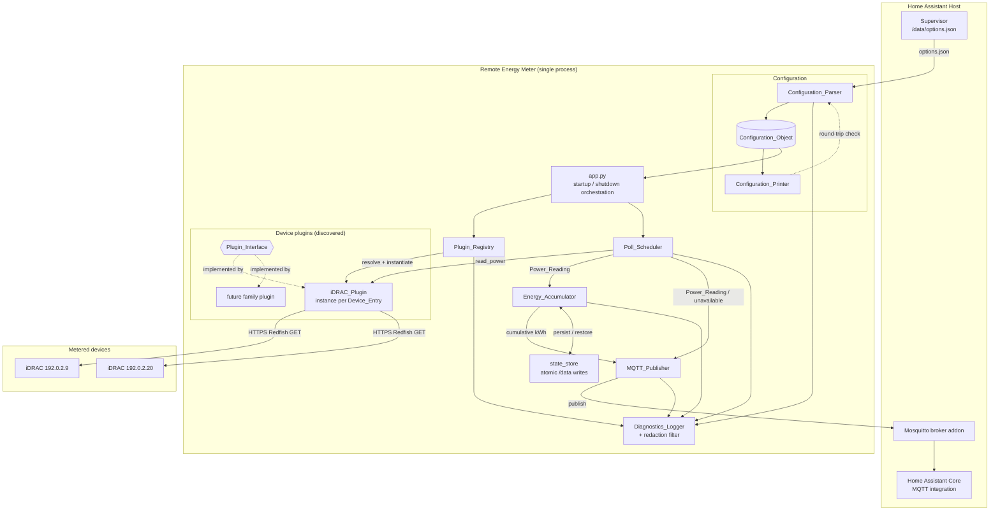
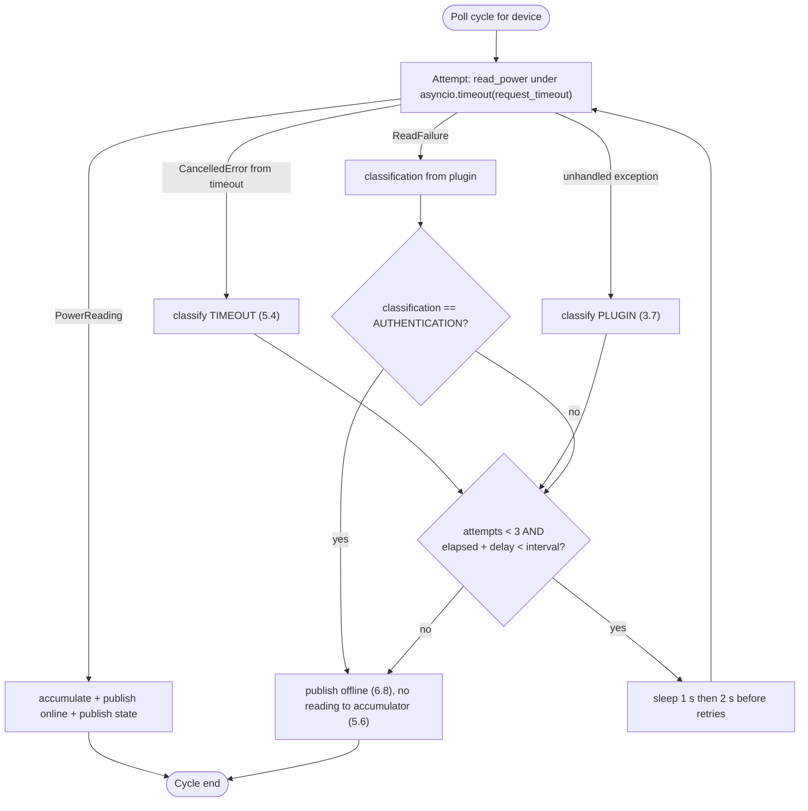

# Design Document

## Overview

Remote Energy Meter is a single-process Home Assistant addon that polls network-attached devices for instantaneous
power, integrates those readings into cumulative energy, and publishes both to Home Assistant over MQTT Discovery.

The process is built around three ideas:

1. **A pure core with an I/O shell.** Configuration parsing, poll-interval and timeout resolution, energy integration,
   MQTT topic and payload construction, and credential redaction are pure functions over plain data. Network I/O
   (Redfish HTTPS, MQTT, file persistence) lives in thin adapters. This split is what makes the correctness properties
   in this document testable without touching a network.
2. **One plugin per device family.** The core never imports a device-specific module. It resolves a `Device_Entry` to a
   `Device_Plugin` through the `Plugin_Registry`, and only ever sees the `Plugin_Interface` and the `Power_Reading`
   contract. Adding Dell iDRAC support and adding a future family are the same operation: drop a module into the
   plugins package.
3. **Per-device fault isolation.** Every device has its own plugin instance, its own scheduler task, its own retry
   budget, its own availability state, and its own energy accumulator. A device that is unplugged, unreachable, or
   returning garbage degrades exactly one Home Assistant device and never the process.

### Target Environment

| Item | Value |
| --- | --- |
| Home Assistant | Supervisor-managed installation (add-on capable) |
| Broker | Mosquitto broker add-on on the same host |
| Metered device 1 | Dell PowerEdge server with an iDRAC 7+ management controller (example address `192.0.2.9`) |
| Metered device 2 | Dell PowerEdge server with a legacy iDRAC 6 management controller (example address `192.0.2.20`) |
| Plugin used | one plugin instance per server (Requirement 4.2) |

Both servers are metered with `Device_Entry` values that differ only in connection parameters. The add-on talks only
to the management-controller addresses, never to the servers' own operating systems. Addresses in this document are
RFC 5737 documentation examples.

### Technology Stack

The prompt proposed Python 3 + asyncio + aiohttp + pydantic + pytest/Hypothesis. That choice is validated below,
with one substitution and one pin.

| Concern | Choice | Rationale |
| --- | --- | --- |
| Language | Python 3.12 | The Home Assistant addon base images ship Python; the ecosystem has first-class Redfish, MQTT, and property-testing libraries. The workload is I/O-bound with negligible CPU, so interpreter speed is irrelevant. A compiled language would buy nothing and cost the plugin story (dynamic module discovery is trivial in Python, awkward elsewhere). |
| Concurrency | `asyncio` | Requirement 5.3 needs all devices polled concurrently with at most one in-flight read per device, and Requirement 5.4/5.5 need cancellable timeouts and timed retries. `asyncio.timeout`, `TaskGroup`, and per-device locks express all of this directly. A thread pool would need explicit cancellation plumbing that HTTP libraries do not offer cleanly. |
| HTTP / Redfish | `aiohttp` 3.x | Async, supports per-request timeouts, `BasicAuth`, and an explicit `ssl` parameter for the TLS verification flag (Requirement 4.8/4.9). Its bundled test server is also the fake Redfish host used in integration tests. A dedicated Redfish SDK is rejected: the addon reads exactly one resource, and SDKs bring sync I/O plus their own retry logic that would fight Requirement 5.5. |
| MQTT | `aiomqtt` 2.x (pinned `>=2.3,<3`) | Idiomatic asyncio interface over the time-proven paho-mqtt engine, with `will` support needed for Requirement 6.6 and clean cancellation for the reconnect loop. Version 3 replaced the paho engine with a sans-io stack; pinning to 2.x keeps the mature transport. Raw `paho-mqtt` is rejected because its callback/thread model would force cross-thread hand-off from the asyncio poll loop. Reconnect backoff is implemented in the addon rather than delegated, because Requirement 6.9 fixes the exact schedule and Requirement 6.13 requires rediscovery to run before any state publish. |
| Config validation | `pydantic` v2 | Requirement 2.2 needs per-field type, range, and presence validation driven by a schema that each plugin publishes; pydantic models give that plus machine-readable error locations, which is what "the first failing field" in Requirement 2.3 reports. `SecretStr` gives credential fields a `repr` that cannot leak (Requirement 8.2). |
| Persistence | stdlib `json` + atomic replace | The state is a few floats per device. A database would add a dependency and a failure mode for no benefit. |
| Tests | `pytest`, `pytest-asyncio`, `Hypothesis` 6.x | Hypothesis is the mature Python property-based testing library, with shrinking and a stateful-testing mode suited to the energy accumulator. |
| Lint / format | `ruff`, `mypy --strict` | Type checking is load-bearing here: the failure-classification taxonomy is an enum, and exhaustiveness checks catch an unmapped classification at build time rather than in a log record. |
| Container base | `ghcr.io/home-assistant/base-python` (multi-arch, pinned by digest in the Dockerfile's single `FROM`) | Supplies Python, `tzdata`, and s6-overlay init, so the addon inherits correct signal forwarding for Requirement 1.5. One image for amd64 and aarch64, so there is no per-architecture mapping to keep in step. |

## Architecture

### Repository Layout

The workspace is a Home Assistant addon *repository* (installable by URL in Supervisor) containing one addon folder.

```
remote_energy_meter/                      # git repo root = addon repository root
├── repository.yaml                       # addon repository metadata (name, url, maintainer)
├── README.md
├── pyproject.toml                        # package metadata, deps, ruff/mypy/pytest config
├── remote_energy_meter/                  # the addon folder (slug: remote_energy_meter)
│   ├── config.yaml                       # addon manifest: name, version, arch, startup, options, schema
│   ├── Dockerfile                        # digest-pinned multi-arch FROM, installs the src package, sets entry point
│   ├── DOCS.md                           # user documentation shown in Supervisor
│   ├── CHANGELOG.md
│   ├── icon.png, logo.png
│   └── rootfs/
│       └── etc/s6-overlay/s6-rc.d/remote-energy-meter/
│           ├── type                      # "longrun"
│           ├── run                       # exec python -m remote_energy_meter
│           └── finish                    # propagates the process exit status
├── src/remote_energy_meter/
│   ├── __main__.py                       # entry point: signal wiring, exit codes
│   ├── app.py                            # startup/shutdown orchestration (Requirement 1)
│   ├── config/
│   │   ├── models.py                     # Configuration_Object, Device_Entry, MqttSettings
│   │   ├── parser.py                     # Configuration_Parser
│   │   ├── printer.py                    # Configuration_Printer
│   │   └── secrets.py                    # HA secret reference resolution
│   ├── plugins/
│   │   ├── interface.py                  # Plugin_Interface, Power_Reading, FailureClassification
│   │   ├── registry.py                   # Plugin_Registry (discovery + resolution)
│   │   ├── conformance.py                # shippable reference test suite (Requirement 10.2)
│   │   └── idrac/
│   │       ├── plugin.py                 # iDRAC_Plugin
│   │       └── schema.py                 # iDRAC connection parameter schema
│   ├── scheduler.py                      # Poll_Scheduler
│   ├── energy.py                         # Energy_Accumulator + integration math
│   ├── state_store.py                    # atomic /data persistence
│   ├── mqtt/
│   │   ├── publisher.py                  # MQTT_Publisher (connection, backoff, retained reading)
│   │   ├── topics.py                     # pure topic + unique_id derivation
│   │   └── discovery.py                  # pure MQTT_Discovery payload construction
│   └── diagnostics/
│       ├── logger.py                     # Diagnostics_Logger setup, level resolution
│       └── redaction.py                  # credential registry + redaction filter
├── tests/
│   ├── unit/                             # example and edge-case tests
│   ├── property/                         # Hypothesis tests, one per correctness property
│   ├── integration/                      # fake Redfish server + local Mosquitto broker
│   ├── conformance/                      # runs plugins.conformance against the iDRAC plugin
│   └── fakes/
│       ├── redfish_server.py             # aiohttp app emulating iDRAC responses
│       └── broker.py                     # Mosquitto subprocess fixture
├── docs/
│   └── writing-a-plugin.md               # developer documentation (Requirement 10.1)
└── .github/workflows/ci.yaml             # lint, type-check, test, addon-lint, image build
```

The Python package lives in `src/` rather than inside the addon folder so that lint, type-check, and test runs work
on a developer machine without a container, while the Dockerfile copies and `pip install`s it. `config.yaml` is the
only place the options schema is declared for Supervisor; `config/models.py` is the only place it is declared for the
process. A CI check asserts the two agree field-for-field, which is how Requirement 1.1 stays true as the schema
grows.

### Component Diagram



Every arrow into `Diagnostics_Logger` passes through the redaction filter, so there is exactly one place where a
credential could reach the log stream, and exactly one place that prevents it.

### Startup Sequence

Requirement 1.3 fixes the order and Requirement 1.4 fixes the failure behavior. `app.py` runs the steps as a list of
named stages so the failing stage name in the error log is not hand-written per call site.

```mermaid
sequenceDiagram
    participant S6 as s6-overlay
    participant App as app.py
    participant Par as Configuration_Parser
    participant Reg as Plugin_Registry
    participant Pub as MQTT_Publisher
    participant Sch as Poll_Scheduler

    S6->>App: exec python -m remote_energy_meter
    App->>App: install SIGTERM/SIGINT handlers
    App->>Par: load(/data/options.json)
    Note over Par: unreadable/unparseable -> exit non-zero (1.7, 2.10)<br/>bad global interval or MQTT section -> exit non-zero (2.7, 2.11)
    Par-->>App: Configuration_Object (accepted entries only)
    App->>App: configure Diagnostics_Logger level (9.2, 9.6, 9.7)
    App->>App: register credential values for redaction (8.1)
    Note over App: zero accepted entries -> exit non-zero (2.4)
    App->>Reg: discover()
    Note over Reg: zero plugins -> exit non-zero (3.8)<br/>duplicate plugin id -> exit non-zero (3.5)
    Reg-->>App: {plugin_id: plugin class}
    App->>Reg: resolve + instantiate per Device_Entry (3.3, 3.6)
    Reg->>Reg: validate_connection() once per instance (3.10)
    App->>Pub: start (non-blocking; failure is not fatal, 6.12)
    App->>Sch: start per-device poll tasks
    Sch-->>App: running
    App->>App: log startup-complete with accepted device count (1.3)
```

The MQTT publisher starts *before* the scheduler but does not block on connection success: Requirement 6.12 requires
the process to keep running and keep polling if the first broker connection fails. The publisher's connection state
machine runs as its own task; the scheduler hands it readings regardless.

### Shutdown Sequence

Requirement 1.5 gives a 10 s budget for the whole shutdown and Requirement 7.3 gives 5 s for energy persistence.
The handler runs both under an outer `asyncio.timeout(10)`:

1. Cancel the scheduler tasks (in-flight reads are cancelled, not awaited).
2. Persist energy state, bounded by `asyncio.timeout(5)` (Requirement 7.3).
3. Publish `offline` availability for every accepted device (Requirement 1.5).
4. Disconnect cleanly from the broker so the last will is *not* fired (the explicit `offline` publishes already
   carry the same meaning, and a clean disconnect avoids a spurious bridge-offline flap).
5. Exit 0.

If the outer timeout fires, the process logs a warning naming the exceeded deadline and exits immediately without
further publication (Requirement 1.6). Persistence is ordered before publication deliberately: losing a kWh total is
permanent, while a missed `offline` publish is corrected by the last will.

## Components and Interfaces

### Configuration_Parser

Reads `/data/options.json` (path injected, defaulted from the Supervisor convention) and produces a
`Configuration_Object`.

```python
class ParseOutcome(NamedTuple):
    config: ConfigurationObject | None    # None only when the whole configuration is rejected
    fatal: FatalConfigError | None        # set when the addon must exit non-zero
    rejections: list[EntryRejection]      # one per excluded Device_Entry

def parse(raw_text: str, schemas: Mapping[str, PluginConfigSchema],
          secrets: SecretResolver) -> ParseOutcome: ...
```

Two distinct severities of failure, matching the requirements:

- **Fatal, whole-configuration** (exit non-zero): unreadable or unparseable text (2.10, 1.7), global poll interval not
  a whole number of seconds or outside 5–3600 s (2.7), missing MQTT host, missing port, or port outside 1–65535
  (2.11), zero accepted entries after validation (2.4).
- **Per-entry, non-fatal** (exclude the entry, log at error, keep going): plugin-schema violation naming the first
  failing field (2.2, 2.3), malformed device identifier (2.12), duplicate identifier compared case-insensitively
  where the first occurrence wins (2.5), empty or oversized credential field (8.5, 8.8), unresolvable secret
  reference (8.6).

Field order matters for Requirement 2.3's "first failing field". pydantic reports errors with a `loc` tuple; the
parser sorts the reported errors by the field's declaration index in the plugin schema so the reported field is
deterministic rather than dependent on pydantic's internal ordering. Determinism here is what makes the rejection
log record reproducible and testable.

Defaults: the global poll interval defaults to 30 s when omitted (2.6); the log level defaults to `info` when omitted
(9.6) and falls back to `info` with a warning when out of set (9.7). Both defaults are applied in the parser, not at
the point of use, so the `Configuration_Object` is fully resolved and the printer can round-trip it.

Secret resolution runs *before* validation (8.4) with a 5 s per-resolution bound, so a resolved empty value is caught
by the same empty-credential rule as a literal empty value.

### Configuration_Printer

```python
def print_config(config: ConfigurationObject) -> str: ...
```

Serializes a `Configuration_Object` back to `options.json`-shaped text. It exists for two reasons: it makes the parser
testable by round-trip (Requirements 2.8, 2.9), and it lets the addon emit a normalized configuration for support
purposes. It writes resolved literal credential values (never secret references, because a reference is not
round-trippable to the same object), so its output is treated as credential-bearing: it is returned as a string to the
caller, never routed to the log stream and never published over MQTT (Requirement 8.3 is about MQTT payloads;
Requirement 8.2 is about log records; the printer touches neither).

The printer omits nothing that the parser needs and adds nothing the parser rejects. Concretely it emits every
field explicitly, including fields that hold their default value, so parse-print-parse is a fixed point on the first
pass rather than the second.

### Plugin_Interface

```python
class FailureClassification(StrEnum):
    AUTHENTICATION     = "authentication"
    TIMEOUT            = "timeout"
    TLS_VALIDATION     = "tls_validation"
    COMMUNICATION      = "communication"
    RESPONSE_FORMAT    = "response_format"
    INVALID_MEASUREMENT = "invalid_measurement"
    PLUGIN             = "plugin"

@dataclass(frozen=True, slots=True)
class PowerReading:
    device_id: str
    watts: float
    measured_at: datetime          # tz-aware UTC

@dataclass(frozen=True, slots=True)
class ReadFailure:
    device_id: str
    classification: FailureClassification
    detail: str                    # redacted before it reaches a log record

ReadResult = PowerReading | ReadFailure

@dataclass(frozen=True, slots=True)
class ValidationResult:
    ok: bool
    classification: FailureClassification | None   # set iff ok is False

class DevicePlugin(Protocol):
    plugin_id: ClassVar[str]                       # 1..64 chars, case-sensitive
    config_model: ClassVar[type[BaseModel]]        # the published configuration schema

    def __init__(self, device_id: str, params: BaseModel) -> None: ...
    async def validate_connection(self, timeout_s: float) -> ValidationResult: ...
    async def read_power(self, timeout_s: float) -> ReadResult: ...
```

Four elements, exactly as Requirement 3.1 enumerates: identifier, schema, validation operation, read operation. The
schema is a pydantic model class rather than a hand-rolled dict, which gives the parser field names, types,
required/optional status, and ranges for free (Requirement 3.1) and gives plugin authors one obvious way to declare a
credential field:

```python
class IdracParams(BaseModel):
    host: str
    username: SecretStr = Field(json_schema_extra={"credential": True})
    password: SecretStr = Field(json_schema_extra={"credential": True})
    verify_tls: bool = True
    power_path: str | None = Field(default=None, max_length=512)
    request_timeout_s: float | None = Field(default=None, ge=1, le=60)
```

`SecretStr` plus the `credential` marker is how Requirement 8.1 identifies credential fields generically, without the
core knowing that iDRAC has a password.

A plugin never sleeps, never retries, and never decides its own timeout. It receives a timeout and returns one result.
Retry policy and scheduling belong to the `Poll_Scheduler` (Requirement 5.5), and keeping that boundary sharp is what
lets a new plugin be written without reasoning about the poll loop.

### Plugin_Registry

Discovery walks the `remote_energy_meter.plugins` namespace package with `pkgutil.iter_modules`, imports each
submodule, and collects module-level classes that satisfy `DevicePlugin`. A module is *not* required to register
itself; presence in the package is the registration (Requirement 10.3).

```python
def discover() -> DiscoveryResult: ...      # {plugin_id: type[DevicePlugin]} + malformed module list
def resolve(entry: DeviceEntry) -> type[DevicePlugin]: ...   # exact, case-sensitive match (3.3)
def instantiate(entry: DeviceEntry) -> DevicePlugin: ...     # one instance per entry (3.6)
```

Discovery outcomes:

| Condition | Behavior | Requirement |
| --- | --- | --- |
| Module missing any interface element | exclude module, log error naming module and each missing element, continue | 3.9, 10.5 |
| Two modules declare the same `plugin_id` | log error naming the identifier, exit non-zero before the scheduler starts | 3.5 |
| Zero plugins discovered | log error, exit non-zero | 3.8 |
| Each discovered plugin | one log record per plugin id, then one naming the total count | 3.2 |
| Entry names an unknown plugin id | reject the entry, log error naming entry id, unresolved id, and all discovered ids; continue with other entries | 3.4 |

One instance per accepted entry (3.6) gives each device its own `aiohttp.ClientSession` and therefore its own
connection pool and TLS context, so a hung socket on one iDRAC cannot occupy the other's connection slot.
`validate_connection` runs exactly once per instance at startup and its result is logged but never used to drop a
device (3.10) — a server that is powered off at addon start still gets an entity and starts reporting when it comes
up.

### iDRAC_Plugin

Reads `PowerConsumedWatts` from the Redfish chassis power resource. Per the
[iDRAC9 Redfish API guide](https://www.dell.com/support/manuals/en-pa/idrac9-lifecycle-controller-v4.x-series/idrac9_4.00.00.00_redfishapiguide_pub/powercontrol?guid=guid-9f052fd5-b3eb-41e4-8bf4-91dcab48b0cd),
the `PowerControl` object of the `Power` resource carries `PowerConsumedWatts` as the actual power drawn by the
chassis, and the resource is reachable at `/redfish/v1/Chassis/<id>/Power` on iDRAC 7 and later
([iDRAC7/8 Redfish reference](https://www.dell.com/support/manuals/en-ca/idrac7-8-lifecycle-controller-v2.30.30.30/redfish_v2.30.30.30/power?guid=guid-aba3700c-8b2b-4d9b-9c89-73c3177055cc&lang=en-us)).
*Content rephrased for compliance with licensing restrictions.*

| Aspect | Design |
| --- | --- |
| Default resource path | `/redfish/v1/Chassis/System.Embedded.1/Power` — the Dell chassis id, used when `power_path` is omitted (4.10) |
| Request | exactly one `GET` per read over HTTPS with HTTP Basic auth from that entry's username/password (4.3) |
| Value extraction | first element of `PowerControl` that carries a `PowerConsumedWatts` member; the plugin also accepts the `Oem.Dell` variant only if the standard member is absent |
| Accepted range | numeric and 0–10000 W inclusive (4.4); otherwise `INVALID_MEASUREMENT` (4.11) |
| Missing value | `RESPONSE_FORMAT`, detail names the requested path (4.5) |
| HTTP 401 / 403 | `AUTHENTICATION` (4.6) — and the scheduler does not retry this class (5.5) |
| Other unsuccessful status, or connect failure | `COMMUNICATION`, detail names the iDRAC host (4.12) |
| Timeout | request abandoned, `TIMEOUT` (4.7) |
| `verify_tls: false` | `ssl=False` on the request, self-signed certificate accepted (4.8) |
| `verify_tls: true` | certificate chain validated; failure returns `TLS_VALIDATION` (4.9) |
| Timestamp | UTC clock read at response receipt, not at request send (4.4) |
| `validate_connection` | one request within the configured timeout; success only when the response satisfies the criterion-4 shape (4.13) |

The response-shape parsing is a pure function `extract_watts(payload: object) -> float | ReadFailure`, separated from
the HTTP call. That separation is what lets the malformed-response cases be property-tested against generated
payloads with no server involved.

TLS verification defaults to `true`, which will fail against a factory iDRAC with a self-signed certificate. This is
deliberate: the insecure setting should be a decision the administrator makes, not a default they inherit. `DOCS.md`
documents `verify_tls: false` for the two target servers.

### Poll_Scheduler

One `asyncio.Task` per accepted device, all supervised by a `TaskGroup`. Per-device tasks rather than a global tick
loop, because Requirement 5.2 allows per-device intervals and Requirement 5.9 makes overrun a per-device decision.

```python
async def _device_loop(dev: ResolvedDevice) -> None:
    next_at = monotonic()                                # first request within 1 s of start (5.1)
    while True:
        await sleep_until(next_at)
        next_at += dev.interval_s                        # fixed schedule, no drift accumulation
        if dev.lock.locked():                            # previous cycle still running (5.9)
            log.info("poll cycle skipped", device_id=dev.id, scheduled_at=next_at)
            continue
        async with dev.lock:                             # at most one read in flight per device (5.3)
            await _run_cycle(dev)
```

Interval and timeout resolution are pure functions, so they are directly property-testable:

```python
def resolve_interval(entry_interval: int | None, global_interval: int) -> tuple[int, bool]:
    """Returns (interval, was_rejected). Device interval wins when in 5..3600 (5.2);
    otherwise the global interval is used and the caller logs the rejection (5.7)."""

def resolve_timeout(entry_timeout: float | None, interval_s: int) -> float:
    """Entry timeout when present; otherwise min(interval_s / 3, 10.0) (5.8)."""
```

A cycle is up to three attempts under a wall-clock budget equal to the device's poll interval (5.5):



An authentication failure is never retried: retrying a wrong credential twice more per cycle achieves nothing and
walks toward an iDRAC account lockout. Every other classification retries at 1 s then 2 s, and the budget check stops
the cycle rather than letting retries bleed into the next scheduled poll.

Unhandled plugin exceptions are caught at the scheduler boundary and converted to a `PLUGIN` read failure (3.7), so a
buggy third-party plugin degrades one device instead of killing the process. This is the reason the scheduler, not the
plugin, owns the try/except.

### Energy_Accumulator

Trapezoidal integration over consecutive readings of one device.

```python
def interval_kwh(prev: PowerReading, curr: PowerReading) -> float:
    hours = (curr.measured_at - prev.measured_at).total_seconds() / 3600.0
    mean_w = (prev.watts + curr.watts) / 2.0
    return round(max(0.0, mean_w * hours / 1000.0), 6)
```

The mean of two power values times elapsed hours divided by 1000, rounded to 6 decimal places (7.1), clamped at zero
so the total never decreases (7.2). Trapezoidal rather than "last value times interval" because power ramps between
polls; with a 30 s interval the trapezoid halves the systematic error of a rectangular rule at no cost.

State per device: `total_kwh` and `baseline: PowerReading | None`.

| Input condition | Effect | Requirement |
| --- | --- | --- |
| First reading after start | store as baseline, total unchanged | 7.7 |
| `measured_at <= baseline.measured_at` | discard reading, keep baseline, total unchanged | 7.8 |
| Gap > 4 × poll interval | discard the interval, total unchanged, **new reading becomes the baseline** | 7.5 |
| Otherwise | total += `interval_kwh`, new reading becomes baseline | 7.1 |
| Computed contribution < 0 | contribute 0 | 7.2 |

The gap rule re-baselines rather than dropping the reading: after a long outage the addon has no basis to claim what
was drawn during the gap, but it does know the current power, so it resumes integration immediately from now.

Persistence to `/data/energy_state.json` happens on a 300 s periodic flush (7.9), on SIGTERM within 5 s (7.3), and
restores at startup (7.4). A persisted total that is unreadable, non-numeric, or negative starts that device at 0 kWh
with an explanatory log record (7.6) — one device's corrupt entry does not discard the others.

Writes are atomic: serialize, write to a temp file in the same directory, `fsync`, `os.replace`. A power cut during a
flush therefore leaves either the previous complete state or the new complete state, never a truncated file that
would trip 7.6 and reset a total to zero.

The persisted baseline timestamp is stored alongside the total (7.3) but is **not** restored as an active baseline:
after a restart the elapsed gap is unknown and usually exceeds the gap threshold, so the first reading after start
always re-baselines (7.7). The stored timestamp is retained for diagnostics.

### MQTT_Publisher

Owns the broker connection, the discovery payloads, and all state publication.

**Topic layout.** `base` defaults to `remote_energy_meter`, `discovery_prefix` defaults to `homeassistant`; both are
configurable.

| Purpose | Topic | Retain |
| --- | --- | --- |
| Bridge availability (last will target) | `remote_energy_meter/bridge/availability` | yes |
| Device availability | `remote_energy_meter/<device_id>/availability` | yes |
| Power state | `remote_energy_meter/<device_id>/power/state` | no |
| Energy state | `remote_energy_meter/<device_id>/energy/state` | yes |
| Power diagnostic attributes | `remote_energy_meter/<device_id>/power/attributes` | no |
| Power discovery config | `homeassistant/sensor/rem_<device_id>/power/config` | yes |
| Energy discovery config | `homeassistant/sensor/rem_<device_id>/energy/config` | yes |

Requirement 6.6 asks the last will to mark *every* device offline, but MQTT allows exactly one will message. The
design resolves this with a two-topic availability model: every entity declares both the bridge topic and its own
device topic with `availability_mode: all`, so a single will published to the bridge topic makes all entities
unavailable at once, while per-device topics still distinguish one unreachable server from a stopped addon. The energy
state topic is retained so a cumulative total survives a Home Assistant restart without waiting for the next poll;
the power state topic is not retained, because a stale wattage displayed as current is worse than no value.

**Discovery payload** (power sensor shown; energy differs in the fields noted):

```json
{
  "name": "Power",
  "unique_id": "rem_<device_id>_power",
  "object_id": "rem_<device_id>_power",
  "state_topic": "remote_energy_meter/<device_id>/power/state",
  "json_attributes_topic": "remote_energy_meter/<device_id>/power/attributes",
  "device_class": "power",
  "unit_of_measurement": "W",
  "state_class": "measurement",
  "availability_mode": "all",
  "availability": [
    {"topic": "remote_energy_meter/bridge/availability", "payload_available": "online", "payload_not_available": "offline"},
    {"topic": "remote_energy_meter/<device_id>/availability", "payload_available": "online", "payload_not_available": "offline"}
  ],
  "device": {
    "identifiers": ["rem_<device_id>"],
    "name": "<display name or device_id>",
    "manufacturer": "<plugin-supplied>",
    "model": "<plugin-supplied>"
  },
  "origin": {"name": "Remote Energy Meter", "sw_version": "<addon version>"}
}
```

The energy entity uses `device_class: energy`, `unit_of_measurement: kWh`, `state_class: total_increasing` (6.3) and
shares the same `device.identifiers`, so both entities land on one Home Assistant device (6.1). `total_increasing` is
the class the Energy Dashboard expects for a monotonic meter, per the
[Home Assistant state class documentation](https://developers.home-assistant.io/blog/2021/09/20/state_class_total),
which is exactly what the accumulator's clamp guarantees.

`unique_id` is `rem_{device_id.lower()}_{power|energy}` — derived from the device identifier and the entity role only,
with no host, port, run counter, or timestamp (6.11). Two runs over the same configuration therefore produce identical
unique ids and Home Assistant reuses the existing entities. Lowercasing is safe because the parser already rejects
identifiers outside `[A-Za-z0-9_-]` (2.12) and treats identifiers case-insensitively for duplicate detection (2.5),
so distinct accepted identifiers cannot collide after lowercasing.

**Publication behavior.**

| Trigger | Action | Requirement |
| --- | --- | --- |
| Device accepted, broker connected | publish both discovery payloads within 5 s, retained | 6.1, 6.5 |
| Reading obtained | publish watts rounded to 1 dp within 2 s, and `online` availability | 6.4, 6.7 |
| Reading obtained | publish operation duration in whole ms as a diagnostic attribute | 9.5 |
| No success yet since start | publish the power entity with no duration attribute value | 9.8 |
| All retries failed | publish `offline` within 2 s of the final failure | 6.8 |
| Connection lost | reconnect forever, delay 1 s doubling to a 60 s cap, process keeps running | 6.9, 6.12 |
| Reconnected | republish all discovery payloads *before* any state or availability value | 6.13 |
| Broker unavailable | keep exactly the most recent reading per device; on reconnect publish it only if its age ≤ 4 × poll interval, else discard | 6.10 |
| Non-finite watts, or outside 0–100000 W | discard, leave last published state unchanged, log the rejected value | 6.14 |

Topic construction, `unique_id` derivation, and discovery payload construction are pure functions in `topics.py` and
`discovery.py` with no client dependency, which is why they can be property-tested directly.

The 6.10 buffer holds one reading per device rather than a queue: Home Assistant's recorder wants a current value, and
replaying a backlog of stale wattages would draw a false history. The age check reuses the same 4 × interval staleness
threshold as the accumulator's gap rule, so a value that is too old to publish is also too old to integrate.

### Diagnostics_Logger

`structlog`-style structured records over the stdlib `logging` module, emitted as one line per record to stdout,
which is what Supervisor presents as the addon log.

Every record carries a UTC timestamp with at least whole-second resolution, exactly one severity from
`debug|info|warning|error`, the device identifier when the record concerns one device, and a message of 1–512
characters, truncated with an ellipsis if a formatted message would exceed 512 (9.1).

Level resolution: configured value when in set (9.2), `info` when omitted (9.6), `info` plus a warning naming the
rejected value when out of set (9.7).

Required records:

| Event | Severity | Content | Requirement |
| --- | --- | --- | --- |
| Startup complete | info | accepted device count | 1.3 |
| Startup step failed | error | failed step name, failure classification | 1.4 |
| Shutdown deadline exceeded | warning | deadline note | 1.6 |
| Entry rejected | error | entry id, first failing field | 2.3 |
| Duplicate identifier | error | duplicated identifier | 2.5 |
| Plugin discovered | info | plugin id (then a total-count record) | 3.2 |
| Read failure | warning | device id, exactly one of `authentication`, `timeout`, `tls_validation`, `read` | 9.3 |
| Poll cycle complete | debug | device id, watts, duration in whole ms | 9.4 |

Requirement 9.3 constrains the *log* taxonomy to four values while the internal enum has seven, because the internal
classifications drive different retry and accumulator behavior. The mapping is explicit and total, and `mypy`
exhaustiveness checking keeps it that way:

| Internal classification | Logged classification |
| --- | --- |
| `AUTHENTICATION` | `authentication` |
| `TIMEOUT` | `timeout` |
| `TLS_VALIDATION` | `tls_validation` |
| `COMMUNICATION`, `RESPONSE_FORMAT`, `INVALID_MEASUREMENT`, `PLUGIN` | `read` |

### Credential redaction

Three layers, ordered from prevention to backstop:

1. **Typed values.** Credential fields are `pydantic.SecretStr`. Their `str` and `repr` render as `**********`, so an
   accidental interpolation of a config object cannot leak (8.2). Plaintext is reachable only through an explicit
   `get_secret_value()` call, which appears in exactly two places: the aiohttp `BasicAuth` construction and the MQTT
   client credentials.
2. **A registry plus a logging filter.** At startup every credential value is registered with the
   `CredentialRegistry`. A `logging.Filter` installed on the root logger rewrites the message and every argument of
   every record before any handler formats it.
3. **Exception scrubbing.** The same filter processes `exc_info` text, so a plugin exception whose message embeds a
   password is redacted before it reaches the log stream or any MQTT payload (8.7).

Requirement 8.2 goes further than exact-match replacement: no log record may contain a substring of a credential of
4 or more characters. The filter implements this as 4-gram shielding — for each registered credential it scans the
record text for any 4-character window of that credential, then expands each hit to the maximal matching span and
replaces the span with the fixed marker `***REDACTED***`. Cost is bounded (a credential is at most 256 characters, so
at most 253 windows per credential per record) and the failure direction is safe: a coincidental collision redacts a
few harmless characters rather than leaking secret ones. The marker is a constant string, so its length reveals
nothing about the credential's length (8.2).

MQTT payloads never carry credentials at all (8.3), enforced structurally rather than by filtering: `discovery.py`
and `publisher.py` build payloads from a `PublishableDevice` view of the entry that contains only the identifier,
display name, manufacturer, model, and plugin id. Credential fields are not present in the type, so a leak would be
a type error rather than a runtime accident.

## Data Models

```python
# ---------- configuration ----------

class MqttSettings(BaseModel):
    host: str                                        # required (2.11)
    port: int = Field(ge=1, le=65535)                # required, ranged (2.11)
    username: SecretStr | None = None                # credential (8.1)
    password: SecretStr | None = None                # credential (8.1)
    client_id: str = "remote_energy_meter"
    base_topic: str = "remote_energy_meter"
    discovery_prefix: str = "homeassistant"
    tls: bool = False

class DeviceEntry(BaseModel):
    device_id: str = Field(min_length=1, max_length=64,
                           pattern=r"^[A-Za-z0-9_-]+$")   # (2.12)
    plugin: str = Field(min_length=1, max_length=64)      # exact match on plugin_id (3.3)
    display_name: str | None = None
    poll_interval_s: int | None = Field(default=None, ge=5, le=3600)   # (2.2, 5.2)
    params: dict[str, Any]                                # validated by the plugin schema (2.2)

class LogLevel(StrEnum):
    DEBUG = "debug"; INFO = "info"; WARNING = "warning"; ERROR = "error"

class ConfigurationObject(BaseModel):
    poll_interval_s: int = Field(default=30, ge=5, le=3600)   # (2.1, 2.6, 2.7)
    log_level: LogLevel = LogLevel.INFO                       # (9.6)
    mqtt: MqttSettings
    devices: list[DeviceEntry] = Field(min_length=1, max_length=50)   # ordered (2.1)

# ---------- runtime ----------

@dataclass(frozen=True, slots=True)
class ResolvedDevice:
    entry: DeviceEntry
    plugin: DevicePlugin
    interval_s: int          # resolve_interval (5.2, 5.7)
    timeout_s: float         # resolve_timeout (5.8)
    lock: asyncio.Lock       # at most one read in flight (5.3, 5.9)

# ---------- rejection reporting ----------

class RejectionReason(StrEnum):
    SCHEMA_VIOLATION = "schema_violation"        # 2.3
    INVALID_IDENTIFIER = "invalid_identifier"    # 2.12
    DUPLICATE_IDENTIFIER = "duplicate_identifier" # 2.5
    UNKNOWN_PLUGIN = "unknown_plugin"            # 3.4
    EMPTY_CREDENTIAL = "empty_credential"        # 8.5
    OVERSIZED_CREDENTIAL = "oversized_credential" # 8.8
    UNRESOLVED_SECRET = "unresolved_secret"      # 8.6

@dataclass(frozen=True, slots=True)
class EntryRejection:
    device_id: str | None
    reason: RejectionReason
    field_name: str | None       # the first failing field (2.3)

# ---------- persisted energy state ----------

@dataclass(frozen=True, slots=True)
class DeviceEnergyState:
    total_kwh: float                       # >= 0 (7.2, 7.6)
    baseline_watts: float | None
    baseline_at: datetime | None           # UTC (7.3)

@dataclass(frozen=True, slots=True)
class EnergyStateFile:
    schema_version: int                    # 1
    updated_at: datetime
    devices: dict[str, DeviceEnergyState]  # keyed by device_id
```

On-disk shape of `/data/energy_state.json`:

```json
{
  "schema_version": 1,
  "updated_at": "2025-01-01T00:00:00Z",
  "devices": {
    "poweredge_a": {"total_kwh": 12.345678, "baseline_watts": 214.0, "baseline_at": "2025-01-01T00:00:00Z"}
  }
}
```

`schema_version` is present from the first release so a future field addition can migrate instead of being rejected
by Requirement 7.6 and silently resetting every total to zero.

Example `options.json` for the target environment:

```json
{
  "poll_interval_s": 30,
  "log_level": "info",
  "mqtt": {"host": "core-mosquitto", "port": 1883, "username": "addons", "password": "!secret mqtt_password"},
  "devices": [
    {"device_id": "poweredge_a", "plugin": "idrac", "display_name": "PowerEdge A",
     "params": {"host": "192.0.2.9", "username": "root", "password": "!secret idrac_a_password", "verify_tls": false}},
    {"device_id": "poweredge_b", "plugin": "idrac", "display_name": "PowerEdge B", "poll_interval_s": 60,
     "params": {"host": "192.0.2.20", "username": "root", "password": "!secret idrac_b_password", "verify_tls": false}}
  ]
}
```

## Correctness Properties

*A property is a characteristic or behavior that should hold true across all valid executions of a system — essentially,
a formal statement about what the system should do. Properties serve as the bridge between human-readable
specifications and machine-verifiable correctness guarantees.*

This feature is suited to property-based testing because its load-bearing logic is pure: configuration parsing and
printing, plugin resolution, interval and timeout resolution, retry and backoff schedules, Redfish payload extraction,
topic and payload construction, energy integration, and credential redaction are all functions from data to data over
input spaces far too large to enumerate. The acceptance criteria that describe container behavior, TLS stack
configuration, and fixed defaults are covered instead by integration, smoke, and example tests as noted in the Testing
Strategy.

The properties below are the consolidated set produced by the prework reflection: criteria describing two halves of
one rule, or one rule applied to several sinks, are expressed as a single property rather than several overlapping ones.

### Property 1: Configuration print-parse round trip

*For any* valid Configuration_Object, printing it and parsing the result yields a Configuration_Object that is
field-by-field equal to the original (global poll interval, log level, every MQTT connection field including secret
values, and the ordered list of Device_Entry values) and produces zero validation failures.

**Validates: Requirements 2.1, 2.8, 2.9**

### Property 2: Accepted entries are exactly the valid entries, in order

*For any* device list interleaving valid Device_Entry values with entries carrying a schema violation, a malformed
device identifier, an absent or whitespace-only credential, a credential longer than 256 characters, or an
unresolvable secret reference, the accepted entries are exactly the valid entries in their original order, and exactly
one error record is emitted per rejected entry naming that entry's identifier and its first failing field.

**Validates: Requirements 2.2, 2.3, 2.12, 8.5, 8.6, 8.8**

### Property 3: Duplicate identifiers resolve to the first occurrence

*For any* device list containing identifiers that are equal when compared without regard to letter case, exactly the
first occurrence of each case-folded identifier is accepted, every later occurrence is excluded, and exactly one error
record naming that identifier is emitted.

**Validates: Requirements 2.5**

### Property 4: Out-of-range global settings reject the whole configuration

*For any* global poll interval that is not a whole number of seconds or falls outside 5–3600 seconds inclusive, and
*for any* MQTT broker port outside 1–65535 inclusive or omitted broker host, the configuration is rejected with a
non-zero exit and an error record naming the offending field; and *for any* interval within 5–3600 and port within
1–65535, the configuration is accepted.

**Validates: Requirements 2.7, 2.11**

### Property 5: Plugin resolution is exact, case-sensitive, and partitions the device list

*For any* set of discovered plugin identifiers and any device list, a Device_Entry resolves if and only if its named
plugin identifier is byte-equal to a discovered identifier; the devices admitted to polling are exactly the resolvable
ones, and each unresolved entry produces an error record naming the entry identifier, the unresolved plugin
identifier, and every discovered plugin identifier.

**Validates: Requirements 3.3, 3.4**

### Property 6: Incomplete plugin modules are excluded and fully reported

*For any* non-empty subset of Plugin_Interface elements removed from a candidate module, the Plugin_Registry excludes
that module, emits an error record naming the module and every missing element, still discovers all conforming sibling
modules, and the reference conformance suite reports a failed result naming every unsatisfied element.

**Validates: Requirements 3.9, 10.4, 10.5**

### Property 7: Device failures are isolated

*For any* set of 1 to 50 accepted Device_Entry values and any subset of them whose plugin fails with any failure
classification or raises any exception, the registry holds exactly one plugin instance per entry, every non-failing
device still produces a Power_Reading in that cycle with unchanged connection state, each raised exception is
converted to a plugin-classified read failure, and the process remains running.

**Validates: Requirements 3.6, 3.7, 4.2**

### Property 8: Connection validation runs once and never gates retention

*For any* set of accepted Device_Entry values and any assignment of validation outcomes to them, the connection
validation operation is invoked exactly once per plugin instance, its result is logged with the entry identifier, and
the set of devices retained for polling equals the full set of accepted entries regardless of the outcomes.

**Validates: Requirements 3.10**

### Property 9: Valid Redfish responses yield faithful readings

*For any* power value that is numeric and within 0–10000 watts inclusive, embedded in any Redfish power payload shape
that carries it, the iDRAC_Plugin returns a Power_Reading whose device identifier equals the Device_Entry identifier,
whose watts value equals the payload value, and whose timestamp is timezone-aware UTC and not earlier than the moment
the request was issued.

**Validates: Requirements 4.4**

### Property 10: Unusable Redfish responses are classified, never raised, and never accumulate

*For any* Redfish response — arbitrary JSON with the power member absent, a power value that is non-numeric or outside
0–10000 watts, or any unsuccessful HTTP status other than 401 and 403 — the iDRAC_Plugin returns a ReadFailure whose
classification is response-format, invalid-measurement, or communication respectively, raises no exception, includes
the requested resource path or host address in its detail, and leaves the cumulative energy total of that
Device_Entry unchanged.

**Validates: Requirements 4.5, 4.11, 4.12**

### Property 11: Connection validation agrees with reading

*For any* Redfish response payload, the connection validation operation issues exactly one request and returns a
successful result if and only if the same payload would yield a Power_Reading from the power reading operation.

**Validates: Requirements 4.13**

### Property 12: Each read uses exactly one request bearing its own entry's credentials

*For any* set of Device_Entry values with distinct credentials polled concurrently, each power reading operation
issues exactly one HTTPS request to its own configured resource, and the HTTP Basic authentication of every observed
request matches the username and password of the Device_Entry that issued it.

**Validates: Requirements 4.3**

### Property 13: The poll schedule is drift-free

*For any* poll interval in 5–3600 seconds and any number of cycles k, the k-th power reading request for a device
begins within 1 second of start_time + k × interval, so scheduling error does not accumulate across cycles.

**Validates: Requirements 5.1**

### Property 14: Interval resolution prefers a valid device interval

*For any* device-specific poll interval value (present or absent) and any global poll interval, the resolved interval
equals the device-specific value if and only if it is present and within 5–3600 seconds inclusive, and equals the
global interval otherwise, with a log record naming the entry identifier and the rejected value whenever a present
device value is not used.

**Validates: Requirements 5.2, 5.7**

### Property 15: Timeout resolution falls back to a capped third of the interval

*For any* poll interval in 5–3600 seconds and any absent request timeout, the resolved request timeout equals
min(interval / 3, 10) seconds; when a request timeout is present, the resolved timeout equals it.

**Validates: Requirements 5.8**

### Property 16: A poll cycle costs no more than its slowest read

*For any* set of accepted Device_Entry values and any assignment of read latencies to them, the elapsed duration of
the poll cycle is at most the largest single-read latency plus 1 second, and no device has two power reading
operations in flight simultaneously.

**Validates: Requirements 5.3**

### Property 17: The retry schedule follows classification and budget

*For any* failure classification and any poll interval, the number of power reading attempts in a cycle is exactly 1
when the classification is authentication failure, and otherwise the largest count up to 3 whose cumulative retry
delays of 1 second then 2 seconds keep the elapsed cycle time for that device below its poll interval, with no attempt
started after that budget is reached.

**Validates: Requirements 5.5**

### Property 18: A fully failed cycle reports unavailable and contributes no energy

*For any* per-device sequence of poll cycle outcomes, every cycle in which no attempt succeeded reports that device to
the MQTT_Publisher as unavailable, passes no Power_Reading to the Energy_Accumulator, leaves that device's cumulative
energy total unchanged, and is followed by a further cycle at the next scheduled time.

**Validates: Requirements 5.6**

### Property 19: Overrunning cycles skip exactly the elapsed scheduled times

*For any* poll interval and any read duration exceeding it, the number of skipped poll cycles for that device equals
the number of scheduled times that elapsed while the cycle was in progress, each skip emits a log record naming the
entry identifier and the skipped scheduled time, and polling resumes at the first scheduled time after completion.

**Validates: Requirements 5.9**

### Property 20: Discovery payloads create one device with one power and one energy entity

*For any* set of accepted Device_Entry values, the published MQTT_Discovery payloads contain exactly two entity
configurations per Device_Entry that share one identical device identifier block; the power configuration declares
device class `power`, unit `W`, and state class `measurement`; the energy configuration declares device class `energy`,
unit `kWh`, and state class `total_increasing`; and every configuration lists the bridge availability topic used by
the registered last will message.

**Validates: Requirements 6.1, 6.2, 6.3, 6.6**

### Property 21: Power state is published if and only if the value is usable

*For any* power value, the MQTT_Publisher publishes a power sensor state equal to that value rounded to 1 decimal
place if and only if the value is a finite number within 0–100000 watts; otherwise it publishes no state, leaves the
previously published state unchanged, and emits a log record naming the entry identifier and the rejected value.

**Validates: Requirements 6.4, 6.14**

### Property 22: Published availability reflects the most recent completed outcome

*For any* per-device sequence of completed poll cycle outcomes, the last availability value published for a device is
`online` if and only if its most recent completed cycle produced a Power_Reading, and after process shutdown the last
availability value published for every accepted Device_Entry is `offline`.

**Validates: Requirements 1.5, 6.7, 6.8**

### Property 23: Reconnect delays double from 1 second and cap at 60 seconds

*For any* reconnection attempt index k, the delay preceding that attempt equals min(2^k, 60) seconds, the attempt
sequence is subject to no maximum count, and the metering process remains running throughout.

**Validates: Requirements 6.9**

### Property 24: At most one reading is retained per device and published only while fresh

*For any* per-device sequence of Power_Reading values obtained while the broker connection is unavailable and any
reconnection time, exactly one reading is retained per device and it is the most recent one; on reconnection it is
published if and only if the elapsed time since its measurement timestamp is at most 4 times that device's poll
interval, and is otherwise discarded without publication.

**Validates: Requirements 6.10**

### Property 25: Entity unique identifiers are deterministic and derived only from the device identifier

*For any* set of accepted device identifiers, the derived entity unique identifiers are pairwise distinct across
devices and entity roles, identical across two independent derivations from the same Configuration_Object, and
unchanged when the MQTT host, port, poll interval, credentials, or wall-clock time change.

**Validates: Requirements 6.11**

### Property 26: Rediscovery precedes every state publication after reconnection

*For any* set of accepted Device_Entry values and any backlog of pending state and availability values at the moment
the broker connection is re-established, every MQTT_Discovery configuration publication appears before every power
state, energy state, and Availability_State publication in the observed publish order.

**Validates: Requirements 6.13**

### Property 27: Cumulative energy never decreases and baselines advance correctly

*For any* sequence of Power_Reading values for one device, including sequences with equal, out-of-order, zero, and
negative-adjacent values, the cumulative energy total is non-negative and never smaller after processing a reading
than before it; the first reading after start leaves the total unchanged and becomes the baseline; and any reading
whose timestamp is earlier than or equal to the baseline timestamp leaves both the total and the baseline unchanged.

**Validates: Requirements 7.2, 7.7, 7.8**

### Property 28: Energy integration is additive under subdivision

*For any* pair of consecutive Power_Reading values within the gap threshold, the interval contribution equals the mean
of the two power values in watts multiplied by the elapsed hours and divided by 1000 rounded to 6 decimal places; and
inserting an intermediate reading whose power is the linear interpolation of the pair at its timestamp produces the
same cumulative total within rounding tolerance.

**Validates: Requirements 7.1**

### Property 29: Gaps beyond the threshold are discarded and rebaselined

*For any* pair of consecutive Power_Reading values for a device, the interval contributes to the cumulative energy
total if and only if the elapsed time between their timestamps is at most 4 times that device's poll interval; when it
exceeds the threshold the total is unchanged; and in both cases the later reading becomes the accumulation baseline.

**Validates: Requirements 7.5**

### Property 30: Energy state survives a persist-restore round trip

*For any* mapping of device identifiers to cumulative energy totals and baseline timestamps, persisting the state and
restoring it yields a state field-by-field equal to the original, including cumulative totals to 6 decimal places and
timezone-aware UTC timestamps.

**Validates: Requirements 7.4**

### Property 31: Corrupt persisted state is isolated to the affected devices

*For any* persisted state in which an arbitrary subset of device entries is unreadable, non-numeric, or negative, each
affected device starts at 0 kWh with a log record naming that device identifier and the rejection reason, and every
unaffected device restores its persisted cumulative total unchanged.

**Validates: Requirements 7.6**

### Property 32: No credential fragment escapes to any sink

*For any* credential value of 4 or more characters and *for any* log record, exception text, or published MQTT payload
that references it — including MQTT_Discovery configuration payloads, power and energy state payloads,
Availability_State payloads, diagnostic attribute payloads, and the registered last will message — the emitted text
contains no substring of that credential of 4 or more characters, and every redaction is the same fixed-length marker
regardless of the credential's length.

**Validates: Requirements 8.2, 8.3, 8.7**

### Property 33: Every log record has the required shape

*For any* sequence of emitted log events, including events whose formatted message exceeds 512 characters, each
emitted record carries a UTC timestamp with at least whole-second resolution, exactly one severity level from
`debug`, `info`, `warning`, `error`, the Device_Entry identifier whenever the event concerns a single Device_Entry, and
a message of 1 to 512 characters.

**Validates: Requirements 9.1**

### Property 34: Level filtering and level fallback are exact

*For any* configured log level value and any sequence of log events, the emitted records are exactly those whose
severity ranks at or above the effective level under `debug` < `info` < `warning` < `error`, where the effective level
is the configured value when it is an exact member of the set and `info` otherwise, and a non-member configured value
additionally produces one warning record naming the rejected value.

**Validates: Requirements 9.2, 9.7**

### Property 35: Failure classification maps onto exactly one logged value

*For any* internal failure classification, a failed power reading operation produces exactly one warning record naming
the Device_Entry identifier and exactly one classification drawn from `authentication`, `timeout`, `tls_validation`,
`read`, according to a total mapping over the internal classification set.

**Validates: Requirements 9.3**

### Property 36: Every polled device is accounted for once per cycle

*For any* set of accepted Device_Entry values and any assignment of outcomes and durations to them, a completed poll
cycle emits exactly one debug record per polled Device_Entry naming that identifier, the power value for successful
reads, and the operation duration as a whole number of milliseconds; and for each successful read the published
diagnostic attribute payload of that device carries the same whole-millisecond duration.

**Validates: Requirements 9.4, 9.5**

### Property 37: Any conforming plugin works against the unmodified core

*For any* synthetic module that satisfies the Plugin_Interface — with an arbitrary plugin identifier of 1 to 64
characters, an arbitrary configuration schema, and arbitrary in-range readings — the Plugin_Registry discovers it and
logs its plugin identifier, and an end-to-end poll cycle produces a Power_Reading, an energy accumulation, and an MQTT
publication using the Poll_Scheduler, Energy_Accumulator, and MQTT_Publisher without modification.

**Validates: Requirements 10.3**

## Error Handling

Errors are classified once, at the point of detection, and every downstream decision reads the classification rather
than re-inspecting the cause. There are three tiers.

### Tier 1: Fatal configuration and startup errors (exit non-zero)

These occur before the scheduler starts and mean the addon cannot do its job at all. Each logs one error record
naming the failed startup step and the failure classification, then exits non-zero without starting the scheduler
(Requirement 1.4).

| Condition | Requirement |
| --- | --- |
| Options file absent, unreadable, or unparseable | 1.7, 2.10 |
| Global poll interval not whole seconds or outside 5–3600 s | 2.7 |
| MQTT host or port missing, or port outside 1–65535 | 2.11 |
| Zero accepted Device_Entry values after validation | 2.4 |
| Zero Device_Plugin modules discovered | 3.8 |
| Two discovered plugins declaring the same identifier | 3.5 |

Duplicate plugin identifiers are fatal while duplicate *device* identifiers are not, and the asymmetry is deliberate:
a duplicate device id has an unambiguous resolution (first wins, Requirement 2.5), whereas a duplicate plugin id makes
every affected `Device_Entry` ambiguous, and guessing would silently meter the wrong device.

### Tier 2: Per-entry rejections (degrade the entry, keep running)

The entry is excluded, one error record names the entry and the specific cause, and validation or resolution continues
with the remaining entries. Causes: schema violation (2.3), malformed identifier (2.12), duplicate identifier (2.5),
unknown plugin identifier (3.4), empty credential (8.5), oversized credential (8.8), unresolved secret reference (8.6).
Sixteen of seventeen configured devices still get metered when one is misconfigured — the alternative, refusing to
start, converts a typo into a total outage.

### Tier 3: Runtime failures (degrade one device for one cycle)

| Internal classification | Cause | Retried in cycle | Logged as | Accumulator effect |
| --- | --- | --- | --- | --- |
| `AUTHENTICATION` | HTTP 401/403 (4.6) | no (avoids account lockout) | `authentication` | no reading passed |
| `TIMEOUT` | request or attempt exceeded its timeout (4.7, 5.4) | yes | `timeout` | no reading passed |
| `TLS_VALIDATION` | chain validation failed with verification on (4.9) | yes | `tls_validation` | no reading passed |
| `COMMUNICATION` | connect failure or other unsuccessful status (4.12) | yes | `read` | no reading passed |
| `RESPONSE_FORMAT` | power member absent (4.5) | yes | `read` | no reading passed |
| `INVALID_MEASUREMENT` | value non-numeric or outside 0–10000 W (4.11) | yes | `read` | total unchanged (4.11) |
| `PLUGIN` | unhandled plugin exception (3.7) | yes | `read` | no reading passed |

A cycle in which every attempt failed publishes `offline` for that device (6.8) and contributes nothing to its energy
total (5.6). The device stays scheduled; nothing is removed from the poll set at runtime.

### Broker and persistence errors

Broker failures never terminate the process. A failed first connection logs and keeps retrying while polling continues
(6.12); a lost connection retries forever with the doubling schedule (6.9) and republishes discovery before any state
on recovery (6.13). While disconnected, exactly one most-recent reading per device is retained and published on
recovery only if still fresh (6.10). Energy accumulation continues throughout, because the accumulator's input is the
scheduler, not the broker — an MQTT outage costs visibility, not kWh.

Persistence failures are logged at warning and retried on the next flush; the in-memory total remains authoritative.
A corrupt persisted entry resets only that device to 0 kWh with a stated reason (7.6). Atomic replace means a crash
during a write cannot produce the truncated file that would trigger that reset.

### Value guards at the boundaries

Two independent range checks are intentional rather than redundant. The plugin rejects values outside 0–10000 W as an
invalid measurement (4.11) because that is the physically plausible range for one PowerEdge chassis. The publisher
rejects non-finite values and values outside 0–100000 W before publishing (6.14) because it must hold for *any*
plugin, including future families with larger draws, and because a NaN reaching a `total_increasing` sensor corrupts
Home Assistant long-term statistics in a way that is tedious to repair.

## Testing Strategy

Four layers, each with a defined job. Unit and property tests run on every commit with no network or container;
integration tests run in CI with a fake Redfish server and a real broker binary; the container layer runs on the
image build.

### Unit tests (examples, defaults, and edge cases)

Cover the criteria the prework classified as EXAMPLE, EDGE_CASE, or SMOKE, where behavior does not vary meaningfully
with input:

- Fixed defaults: global interval 30 s (2.6), log level `info` (9.6), iDRAC schema defaults and requiredness (4.1),
  the default Redfish chassis power path (4.10).
- Terminal conditions: unreadable options (1.7), read-versus-parse discriminator (2.10), zero accepted entries (2.4),
  zero plugins discovered (3.8), duplicate plugin identifier (3.5).
- Startup and shutdown behavior: ordered startup steps and the startup-complete record (1.3), per-step failure
  handling (1.4), shutdown deadline exceeded (1.6), SIGTERM persistence within 5 s (7.3), 300 s periodic flush
  against a virtual clock (7.9).
- Fixed MQTT behaviors: retain flag on discovery publishes (6.5), last will registration (6.6), first-connection
  failure being non-fatal (6.12), power entity published without a duration attribute before the first success (9.8).
- Specific failure statuses and cancellations: HTTP 401 and 403 (4.6), plugin-level timeout (4.7), scheduler-level
  cancellation (5.4).
- Credential and secret mechanics: the derived credential field set (8.1), resolution ordering and the 5 s bound (8.4).
- Schema agreement: `config.yaml` options schema covers every field the parser reads (1.1).
- Documentation completeness: one section per interface element, failure classification, and Power_Reading field
  (10.1).

Deliberately kept lean. Anything with a large input space belongs in the property layer; duplicating it here produces
tests that fail together and are maintained twice.

### Property-based tests (Hypothesis)

Each of the 37 correctness properties is implemented as exactly one Hypothesis test, configured for a minimum of 100
examples, and tagged with a comment naming the feature and property:

```python
# Feature: remote-energy-meter, Property 27: For any sequence of Power_Reading values for one device ...
@settings(max_examples=200, deadline=None)
@given(readings=reading_sequences())
def test_cumulative_energy_never_decreases(readings: list[PowerReading]) -> None:
    ...
```

Property-based testing is not implemented from scratch; Hypothesis provides generation, shrinking, and the
`RuleBasedStateMachine` used for the accumulator sequence properties (27, 29) where the interesting behavior is a
sequence of state transitions rather than a single call.

Shared generators live in `tests/property/generators.py`:

| Generator | Produces | Used by |
| --- | --- | --- |
| `configuration_objects()` | valid Configuration_Objects across the full field space | 1, 25, 32 |
| `device_lists(valid_ratio)` | device lists interleaving valid entries with mutated ones | 2, 3, 5 |
| `entry_mutations()` | drop/blank/retype/out-of-range/bad-interval/oversized-credential/unresolvable-secret | 2 |
| `device_identifiers()` | arbitrary text plus targeted `[A-Za-z0-9_-]` and 64/65-length boundaries | 2, 25 |
| `redfish_payloads()` | valid, member-absent, wrong-typed, and out-of-range power payloads | 9, 10, 11 |
| `failure_classifications()` | the internal classification enum | 7, 17, 35 |
| `reading_sequences()` | reading sequences with adversarial timestamps and values | 27, 28, 29 |
| `energy_states()` | device totals and baselines, plus corrupted variants | 30, 31 |
| `credentials()` | credential values of 4–256 characters across scripts and byte ranges | 32 |
| `synthetic_plugins()` | modules conforming to, or missing a subset of, the interface | 6, 37 |

Timing-sensitive properties (13, 16, 17, 19, 23, 24) run against a virtual clock rather than `sleep`, so 100+
examples of a 3600 s interval complete in milliseconds. The scheduler takes its clock and sleep function by injection
for exactly this reason; wall-clock behavior is verified once in the integration layer.

Properties 7, 12, 16, 18, 22, 26, and 36 exercise the scheduler and publisher against fake plugins and a recording
fake MQTT client — mocks at the boundary, real logic inside — which is what keeps 100+ iterations of a multi-device
poll cycle cheap enough to run on every commit.

### Integration tests

Real transports, small example counts, covering what the prework classified as INTEGRATION:

- **Fake Redfish server** (`tests/fakes/redfish_server.py`): an `aiohttp` app serving the chassis power resource, with
  switchable behaviors for valid responses, missing members, HTTP statuses, and stalls. Served over HTTPS with a
  generated self-signed certificate to cover the TLS verification flag in both directions (4.8, 4.9) — the one place
  where the real TLS stack, not a mock, must be exercised.
- **Local broker**: a Mosquitto subprocess fixture on an ephemeral port. Tests subscribe as Home Assistant would and
  assert the discovery payloads, the state and availability topics, retain flags, and the last will after an ungraceful
  client kill. Skipped with a clear message when the binary is absent, and installed in CI so it never silently
  skips there.
- **End-to-end**: two fake iDRAC endpoints standing in for `192.0.2.9` and `192.0.2.20`, one addon process, a real
  broker. Asserts two Home Assistant devices with four entities, wattage tracking the fake endpoints, and a cumulative
  energy total that grows monotonically across cycles. Then restart the process and assert the energy totals resume
  from the persisted values and the entity unique identifiers are unchanged (6.11, 7.4).
- **Container**: build the image and assert the container exit status equals the metering process exit status (1.2),
  and that SIGTERM to the container produces `offline` availability and exit 0 (1.5).

### Plugin conformance suite

Requirement 10.2 asks for a reference suite that plugin authors can run, so the suite ships *inside the package* as
`remote_energy_meter.plugins.conformance`, not in `tests/`, and is invoked with the plugin under test as a parameter:

```python
from remote_energy_meter.plugins.conformance import assert_plugin_conforms

def test_idrac_conforms() -> None:
    assert_plugin_conforms(IdracPlugin, valid_params=..., invalid_params=...)
```

The suite checks that the plugin identifier is a non-empty string of at most 64 characters, that the configuration
schema accepts a valid Device_Entry and rejects one with a missing required field, that `validate_connection` returns
either a success result or a classified failure, and that `read_power` returns a Power_Reading carrying the device
identifier, watts within 0–100000, and a UTC timestamp. Each failed check names the Plugin_Interface element that was
not satisfied (10.4). The suite's own correctness is verified by running it against generated conforming and
deliberately defective synthetic plugins (Property 6).

### CI pipeline

`ruff check`, `ruff format --check`, `mypy --strict`, `pytest` (unit, property, conformance), `pytest -m integration`
with Mosquitto installed, the Home Assistant addon linter against `config.yaml`, and a multi-arch image build. The
schema-agreement test (1.1) and the docs-completeness test (10.1) run in the default suite so a new configuration
field cannot merge without appearing in the Supervisor schema and a new failure classification cannot merge
undocumented.

## Hardware Validation Addendum (2026-09-05)

The live protocol split supersedes the original two-Redfish-device environment assumption without changing historical
Properties 1–37:

| Management address | Production plugin | Validated protocol | Observed result |
| --- | --- | --- | --- |
| `192.0.2.9` | `idrac` | HTTPS Redfish (iDRAC 7+) | 162 W |
| `192.0.2.20` | `ipmi` | IPMI v2/RMCP+ `lanplus`, cipher suite 3 (legacy iDRAC 6) | `System Level` = 112 W; DCMI unsupported |

The IPMI implementation lives wholly under `plugins/ipmi/`. A pure parser converts `Sensor Reading` text into a watt
value or a classified failure. Both interface operations call one private read path that creates exactly one
`ipmitool` process with `create_subprocess_exec`, applies an outer timeout plus bounded `-N`/`-R` transport settings,
and terminates, escalates to kill, and reaps the child on timeout or cancellation. The command runner and executable
are injectable. The password exists in plaintext only in the child environment as `IPMI_PASSWORD` and is selected with
`-E`; command arguments, representations, failure details, and logs cannot carry it.

Cipher suite 3 is a legacy interoperability choice, not a security recommendation. Deployment guidance confines UDP
623 to the management network, enables only IPMI-over-LAN, and uses a dedicated least-privilege sensor-reading account.
No DCMI or SNMP dependency is introduced.

### Property 38: IPMI sensor parsing is faithful and total

*For any* finite watt value in 0–100000 embedded in a syntactically valid `Sensor Reading` line, parsing returns that
exact value; and *for any* generated output without a parseable watt reading, parsing returns a response-format failure
rather than a value or exception.

**Validates: Requirements A.3**


## Companion Integration Design Addendum (2026-09)

The complete companion design consists of two separately packaged parts. The add-on replaces generic MQTT entity
configuration publication with a versioned local-push protocol: a one-shot Supervisor announcement, pure inventory
generation, retained legacy cleanup, and preserved state, availability, energy, and attribute transport. The
`custom_components/remote_energy_meter` package consumes that protocol and owns Home Assistant devices and sensors.
The artifact builders and validators do not deploy either component, restart Home Assistant, or access a live broker.

### Discovery and protocol boundary

The add-on manifest allowlists `remote_energy_meter` under `discovery`. After its publisher starts, the application
best-effort posts this exact credential-free Supervisor body using the bearer token only as an HTTP header:

```json
{"service":"remote_energy_meter","config":{"instance_id":"remote_energy_meter","base_topic":"remote_energy_meter","inventory_topic":"remote_energy_meter/integration/devices","schema_version":1}}
```

`instance_id` is stable for the one supported add-on instance and becomes the config-flow unique ID; the Supervisor
message UUID is transport metadata and never identity. Rediscovery replaces changed topic metadata and reloads the
existing entry, with a manual `base_topic` flow as fallback.

On every broker connection the publisher performs one ordered transaction:

1. retained empty payload to each current device's legacy power config topic;
2. retained empty payload to each current device's legacy energy config topic;
3. one retained schema-1 inventory on `<base_topic>/integration/devices`;
4. attribute placeholders, bridge online, and any fresh buffered state.

The schema-1 inventory is:

```json
{
  "schema_version": 1,
  "instance_id": "remote_energy_meter",
  "base_topic": "remote_energy_meter",
  "bridge_availability_topic": "remote_energy_meter/bridge/availability",
  "devices": [{
    "device_id": "poweredge_a",
    "name": "PowerEdge A",
    "plugin_id": "idrac",
    "availability_topic": "remote_energy_meter/poweredge_a/availability",
    "power_state_topic": "remote_energy_meter/poweredge_a/power/state",
    "energy_state_topic": "remote_energy_meter/poweredge_a/energy/state",
    "power_attributes_topic": "remote_energy_meter/poweredge_a/power/attributes"
  }]
}
```

Optional device metadata is limited to `manufacturer` and `model`. No plugin parameter mapping exists at this boundary.
The companion parser requires exact field sets, the supported version, unique valid IDs, and the schema's exact topic
layout under the configured base; malformed inventory or state leaves prior typed state intact.

### Home Assistant runtime

The runtime lives under `custom_components/remote_energy_meter` and uses a push-only
`RemoteEnergyMeterCoordinator`: `update_interval` is absent. Its first config-entry refresh waits only for the MQTT
integration and subscribes to inventory. A valid retained inventory installs exact bridge/device/state/attribute
subscriptions, preserves existing values when a device's state topics are unchanged, marks removed devices
unavailable, and calls `async_set_updated_data`. The sensor platform tracks announced IDs and adds two entities only
for new IDs, so inventory growth requires neither entry nor platform reload.

Both entities are `CoordinatorEntity` + `SensorEntity`. Their stable IDs are
`rem_<lowercase-device_id>_{power|energy}` and each reports `DeviceInfo(identifiers={(DOMAIN, device_id)})`. Power uses
`SensorDeviceClass.POWER`, W, `MEASUREMENT`, and `duration_ms`; energy uses `SensorDeviceClass.ENERGY`, kWh, and
`TOTAL_INCREASING`. Availability requires coordinator health plus bridge online plus device online.

Diagnostics return config metadata and typed availability summaries, not raw MQTT payloads. Redaction is intentionally
absent because the Supervisor and inventory contracts cannot carry credentials.

### Distribution and validation

The source integration remains separate from the add-on image. `tools/build_local_integration_bundle.py` produces a
deterministic directory and zip whose copy-ready path is `custom_components/remote_energy_meter`, along with local
installation guidance and checksums. `tools/validate_integration_package.py` requires the manifest, strings, English
translation, compilable Python, and absence of credential material. Neither tool copies into Home Assistant, restarts
Core, deploys the add-on, or accesses a live broker.

### Property 39: Inventory round-trip is exact and credential-free

*For any* accepted set of zero to fifty case-insensitively unique device IDs, any valid MQTT base topic, and any
broker credentials, inventory generation followed by JSON decoding preserves the ordered devices, public metadata,
and every exact derived topic. The serialized document contains neither credential-bearing fields nor credential
values, and its top-level and per-device field sets match schema version 1 exactly.

**Validates: Requirements B.2, B.3**

### Property 40: Migration cleanup and inventory precede state on every connection

*For any* accepted device set, reconnect count, and assignment of fresh buffered readings, each connection publishes
exactly two retained empty legacy configs per device, then exactly one retained inventory, before every attribute,
state, or availability publication on that connection.

**Validates: Requirements B.4**
